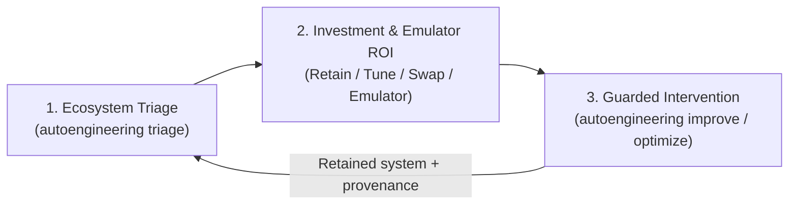

# Autoengineering: Vision & North Star Guidance

> **Purpose of this document:** This is not a feature roadmap or a sprint backlog. It is a permanent reminder of *why Autoengineering exists*, *what "better" means* in complex scientific modeling ecosystems, and *what capabilities define the tool*. Every architectural decision, command, and example should serve these goals.

---

## 1. The Core Idea

Modern earth, energy, climate, and water systems are not single models—they are **interdependent ecosystems of connected models**. A land-surface model (`CLM5` or `ELMv3`) feeds surface and subsurface runoff into a river-routing and reservoir-management model (`MOSART-WM`), which simultaneously ingests gridded municipal, agricultural, and industrial water demands (`Tethys`), which in turn depend on socioeconomic and energy projections (`GCAM`).

When the terminal output of that chain disagrees with reality—or takes 50,000 HPC core-hours to run a single scenario—domain teams face a systems-engineering dilemma:

- **Where is the bottleneck?** Is downstream streamflow error coming from land-surface baseflow partitioning, irrigation demand downscaling, or reservoir release rules?
- **What is the right intervention?** Should we calibrate parameters, swap in a different physical formulation, replace a sluggish physics component with a fast AI emulator, or leave the component alone because downstream reservoirs damp its error anyway?
- **What is the return on investment (ROI)?** If we spend three months or 20,000 GPU-hours building an AI surrogate or calibrating a submodel, how much compute time, downstream accuracy, or scientific insight do we actually gain?

**Autoengineering applies systems engineering to connected modeling ecosystems to semi-autonomously identify where to invest resources to make them better—and executes bounded, physically guarded experiments to prove the gain.**

---

## 2. What "Value of Improvement" Means

In scientific modeling ecosystems, "cost savings" and "improvement" are multi-dimensional. Autoengineering explicitly measures and trades off three forms of value:

1. **Time & Computational Efficiency (HPC & Wall-Clock Savings):**
   - Reducing a component's execution cost from thousands of NERSC Perlmutter node-hours to seconds via a targeted AI emulator or simplified physics module.
   - Turning a workflow that can only afford 1–3 deterministic runs into one that can run 1,000-member climate, policy, and parameter ensembles.
2. **Downstream Scientific Accuracy & Decision Fidelity:**
   - Improving terminal and intermediate skill across the physical regimes that actually matter for decisions—not just mean hydrograph scores (`KGE`, `NSE`, `RMSE`), but regime-specific behavior: low-flow volume bias (`Q10 PBIAS`), multi-month drought event detection (`SRI-3 CSI` and false-alarm ratio), reservoir storage drawdowns, and regional unmet water demand (`km³/yr`).
3. **Scientific Understanding & Causal Attribution:**
   - Separating *upstream structural physics deficits* (e.g., missing perched water tables or over-drained baseflow in headwater basins) from *human-system coupling errors* (e.g., surface- vs. groundwater withdrawal shares, irrigation canal-loss efficiency, or rule-curve release heuristics).
   - Knowing *where not to invest* is as valuable as knowing where to invest: demonstrating that a component's error is attenuated by downstream storage prevents wasted engineering effort.

---

## 3. The Three Hallmark Capabilities

Autoengineering is built around three core capabilities that work together as a disciplined engineering loop:

### Capability 1: Ecosystem Bottleneck & Error-Propagation Triage (`autoengineering triage`)
Before modifying any model or launching an expensive search, Autoengineering empirically diagnoses the connected system:
- **Cost & Runtime Profiling:** Measures wall-clock runtime per component and accounts for declared upstream HPC production costs (e.g., NERSC node-hours per simulation year) alongside parameter dimensionality and data support.
- **Empirical Error-Propagation Probing:** Perturbs intermediate component outputs (scale/bias, noise attenuation, or oracle/reference blending) and runs the downstream graph to measure **downstream Jacobian sensitivity**—how much a $10\%$ improvement in Component $A$ actually changes terminal metrics in Component $C$.
- **Regime-Aware Attribution:** Evaluates sensitivity across distinct physical subsets (e.g., small natural headwaters where land-surface runoff dominates vs. heavily regulated river basins where reservoir operating rules and demand withdrawals dominate).

### Capability 2: Investment & Emulator ROI Assessment
Operationalizing the criteria in [`docs/model-improvement.md`](docs/model-improvement.md), Autoengineering translates triage measurements into an explicit engineering recommendation for each component:

| Recommendation | When Autoengineering Selects It |
| --- | --- |
| **Retain Baseline** | Downstream terminal metrics are insensitive to this component's output perturbations, or existing performance already satisfies physical and accuracy thresholds. |
| **Parameter Calibration (`optimize`)** | Component has high downstream sensitivity, a sound physical structure, low per-evaluation runtime, and sufficient observation support relative to its parameter count. |
| **Physics / Component Swap (`improve`)** | Component exhibits structural regime failure (e.g., systematic low-flow drought bias or missing human-water coupling) that parameter tuning cannot fix, and alternative formulations exist. |
| **AI Emulator Replacement** | Component dominates system compute cost (e.g., $>80\%$ of HPC node-hours) while its input-output mapping is smooth enough that a statistical or ML surrogate can achieve massive speedup within acceptable downstream error tolerance. Includes explicit **break-even math** (training/data cost vs. per-scenario compute savings). |

### Capability 3: Agent-Driven Intervention with Hard Physical Guardrails (`autoengineering improve` & `optimize`)
When an intervention is selected, Autoengineering pairs modern coding agents (via `.claude/skills/`) with a deterministic scientific harness:
- **Literature & Code Synthesis Outside the Harness:** Coding agents inspect the triage report, search the literature, and implement candidate replacements, parameterizations, or fast emulators as clean Python/BMI/OpenMDAO callables.
- **Hard Physical Vetoes Inside the Harness:** Scalar metrics (`KGE`, `NSE`, `RMSE`) are notorious for Goodhart's Law—a model can improve `KGE` by violating mass conservation, predicting negative stores, or destroying low-flow drought skill. Autoengineering enforces **hard physical checks** (`nonnegative`, `mass_balance`, `capacity_bounds`, and `max_degradation` on secondary regime metrics) as strict vetoes during `auto_improve` and `optimize`. Any candidate that violates a physical check is rejected (`vetoed`), regardless of its scalar fitness score.

---

## 4. What Autoengineering Is Not (Anti-Goals)

To keep the toolkit sharp, maintainable, and genuinely useful to working scientists, Autoengineering explicitly avoids:

1. **Reinventing Agent Harnesses:** Autoengineering does not build custom LLM host wrappers, API subscription lease brokers, or multi-agent role schedulers. Modern coding agents (Claude Code, Cursor, Antigravity) already excel at orchestrating code and literature search; they interact with Autoengineering by invoking its CLI and Python API.
2. **Audit Bureaucracy Over Science:** Provenance exists to make experiments reproducible and transparent (recording git hashes, input digests, metrics, physical checks, and runtime)—not to bury scientific models under tens of thousands of lines of container receipts and ceremonial state machines.
3. **Black-Box Metric Gaming:** Autoengineering never selects models on held-out test splits and never trades away physical conservation laws for a marginal gain on a single aggregate score.
