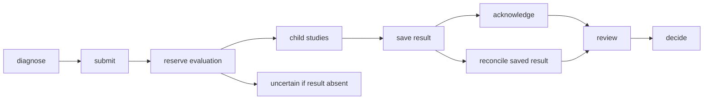

# Prototype responsibilities and recovery

| Responsibility | Owner and implementation |
| --- | --- |
| Rationale, adapter description, recommendation | Host worker, structured JSON |
| Tool admission and ordering | `control.request`, schema and five legal steps |
| Candidate identity | Supplied gamma implementation digest, never a worker import path |
| Calibration | Existing `OptimizationStudy`, separate immutable family ledgers |
| Acceptance | Fixed evaluator plus frozen task, worker cannot substitute a score |
| Persistence | Control process owns state and request records; per-directory writer lock |
| Host transport | CLI subprocess route or direct standalone calls |
| Scientific execution | Trusted supplied functions, arrays copied at their boundary |
| Worker filesystem restrictions | Tested macOS sandbox denies the repository across checkouts |

`Candidate.name` still identifies a component target in the legacy replacement API. The pilot
uses a separate candidate version `supplied-gamma-v1`, bound to the source digest. It does not
change legacy retention semantics. The physical YAML graph, five-step agent workflow, and
child-study lineage remain distinct records.

Example request: `{"id":"submit","tool":"submit","payload":{"candidate":"supplied-gamma-v1"}}`.
The response includes admission status, candidate identity, and implementation hash. Evaluation
returns child choices, fitting and comparison metrics, checks, counts, and the executable decision.
Review and decision requests must name that decision. Extra fields and unknown tools are rejected.

The campaign hash includes the task, model modules, hidden glue, package source, input bytes,
lockfile, and prototype modules. Changed identity refuses continuation. Compatible child studies
use the same paths and input hashes. Result-before-ack recovery reads the durable result and
advances without rerunning numerical work. Request IDs reconcile duplicates and reject conflicting
payloads. A nonblocking advisory lock rejects simultaneous writers.

This sketch uses atomic replacement of a cumulative state snapshot, not a general append-only
campaign ledger. Request history is derived and rebuildable. It lacks hostile-artifact ingestion,
active-child termination, and persistent accounting for malformed requests. Those are explicit
Part 2 requirements. The CLI is a trusted control interface, not a service exposed to worker code.
A host plugin must broker requests across the permission boundary; the worker must never receive
the evaluator's process privileges.
