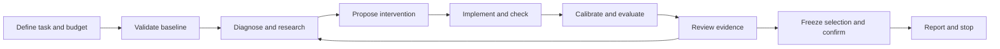

# Autoengineering development plan

Build Autoengineering into a system that can investigate a modeling problem, propose and implement
changes, run controlled experiments, and explain what the evidence supports. Develop the agent
workflow and scientific interfaces together, using real examples to decide which capabilities
deserve further investment.

Start with a portable orchestrator exposed through an existing agent harness. Keep scientific
execution, budgets, acceptance, and evidence under Autoengineering's control. Build a dedicated
agent harness only if a prototype demonstrates a requirement that existing harnesses cannot meet.

This plan extends the [roadmap](roadmap.md), drawing on the
[agentic tools landscape](../background-research/similar-tools/agentic-tools-landscape.md).
It proposes development and evaluation work, not new claims of performance. Existing BO backends
remain experimental, and their frozen protocols and adverse results remain intact.

## 1. Investigate the architecture through one complete workflow

The [detailed investigation plan](investigation-plans/01-agentic-architecture.md) defines the
task audit, reference studies, prototype comparison, and architecture decision gates.

Use Leaf River as the first development case because it already has measured observations, cached
inputs, and a replacement workflow. Define a bounded task: diagnose a baseline deficiency, propose
a component change, implement it, calibrate it, and decide whether to retain it. Establish the data
split and acceptance criteria before agents inspect evaluation feedback.

Investigate three delivery options against that same task:

- A plugin for an existing coding-agent harness, using structured tools and durable external state.
- A small standalone orchestrator that invokes interchangeable agent workers.
- A dedicated harness with its own agent runtime, tool permissions, and execution lifecycle.

Prototype the first option and enough of the second to test portability. Compare integration effort,
interruption recovery, model/provider portability, isolation, observability, and operating cost.
Keep model execution adapters separate from agent-host adapters. A change of coding agent should
not require a new scientific evaluator.

Inspect a few reference implementations in depth: the Modelica study for scientific acceptance,
G-Sim or SGA for structure/calibration separation, and TusoAI or SOCIA-EVO for bounded search and
retained intervention history. Verify licenses and executable behavior before adopting code.
Use the landscape as a starting point, not as a reproduced benchmark.

__Exit criterion:__ a short architecture decision, a frozen development-task specification, and
an executable sketch that carries one supplied candidate from proposal to recorded decision.

## 2. Codify the workflow and shared contracts

The [detailed implementation plan](implementation-plans/part-2-workflow-contracts.md) defines the
campaign records, adapter lifecycle, acceptance rules, recovery, and implementation gates. Part 1
is accepted for this handoff. Strict token enforcement and other-model support are deferred.

Make the workflow an explicit state machine:

Specify the inputs, outputs, responsible role, retry limit, and stop condition for every transition.
Allow explicit outcomes such as no suitable intervention, insufficient data, infeasible candidate,
and exhausted budget. A completed workflow may correctly retain the baseline.

Create a versioned campaign specification containing objectives, hard scientific constraints,
allowed changes, data access, budgets, and acceptance rules. Distinguish the physical model graph,
agent task graph, and experiment lineage. Connect them through stable identities without merging
their different meanings into one graph.

Unify existing model records incrementally around component versions, units, shapes, grids, time
support, parameters, observations, and data provenance. Define an adapter lifecycle for preparation,
validation, optional training, execution, inspection, and cleanup. Initially wrap a coupled solver
as one component rather than pretending a feedback system is a feed-forward DAG.

Give each candidate a testable hypothesis, source evidence, implementation identity, expected
benefit, estimated cost, and eligibility assessment. Record both unsuccessful and successful
interventions. Separate structural changes from inner parameter calibration and account for both.

Build a campaign record above the existing optimization ledger. New candidate code or a changed
search policy creates a new identified child study. Do not mutate the identity of a resumed study.
Make scientific constraints enforceable in the new workflow rather than inheriting the replacement
loop's current behavior, where thresholds only annotate results. Preserve legacy behavior explicitly.

__Exit criterion:__ one supplied replacement and one parameter search use the same model identities,
acceptance rules, and result format. Contract tests cover incompatible interfaces, missing data,
failures, interruption, and replay without changing existing ledger semantics.

## 3. Implement a small multi-agent system

The [detailed implementation plan](implementation-plans/part-3-multi-agent-system.md) defines the
role contracts, host integration, permissions, generated-code admission, recovery, and acceptance
gates above the [Part 2 campaign handoff](part-3-campaign-handoff.md).

__Status: implemented and locally verified for the bounded macOS ARM64 delivery.__ The
[final audit](reviews/part-3-final-audit.md) maps all seven increments to executed evidence.
The three-route Leaf River pilot completed with identical scientific choices and added agent
overhead. Independent confirmation, broader utility and the original deferred scope remain
outside this delivery.

Start with four roles, activated as needed rather than keeping every agent running continuously:

| Role | Responsibility | Required output |
| --- | --- | --- |
| Orchestrator | Maintain the campaign, delegate bounded tasks, allocate budget, and choose the next permitted step | Task assignments and recorded decisions |
| Investigator | Inspect diagnostics, research alternatives, and propose falsifiable interventions | Candidate briefs with sources and expected tradeoffs |
| Implementer | Build adapters or replacements and repair bounded execution problems | Versioned code and interface checks |
| Reviewer | Challenge scientific assumptions and check acceptance evidence independently of the implementer | Acceptance findings and unresolved issues |

Put workflow transitions and budget enforcement in ordinary code. The orchestrator's LLM can
recommend an action, but cannot bypass those rules. Numerical evaluation is a service, not an
agent opinion. The reviewer informs decisions but cannot substitute prose for executed checks.

Use structured handoffs, an artifact store, and an append-only event history as shared memory.
Store hypotheses and their measured outcomes so later agents can avoid repeating failed work.
Give workers isolated candidate workspaces and bounded tool access. Protect the evaluator,
acceptance definitions, and final holdout from candidate code. Run generated implementations in an
explicit isolation boundary with resource limits before admitting them to experiments.

Implement one agent-host integration first, through CLI/JSON tools or MCP if the selected host
supports the required lifecycle. Prove a second host can execute the same contract before committing
to a custom runtime. Add parallel candidate work only after serial recovery works. Use unique task
identities and budget reservations to reconcile duplicate messages, retries, and interrupted workers.
Keep a single authoritative writer for scientific records.

__Exit criterion:__ Leaf River runs from task definition to a reproducible report, survives an
interrupted worker, respects all budgets, and rejects a deliberately invalid candidate. Save model
identifiers, prompts, tool actions, and outputs so execution can be audited even when new LLM calls
are not exactly reproducible.

## 4. Add established capabilities where examples need them

The [detailed implementation plan](implementation-plans/part-4-interoperability.md) defines
BMI semantics, external optimizer selection, coupled and solar examples, conditional integrations,
and the recovery, verification and adoption gates. Its bounded macOS ARM64 delivery
is complete in the [final audit](reviews/part-4-completion-audit.md). This includes
the qualified BMI subset, selected experimental Optuna policy, real coupled circuit,
solar workflow and installed reports. Linux runtime is unverified. PyMT extensions,
DAKOTA and Ray remain deferred under their recorded need gates. The
[Part 5 handoff](part-4-handoff.md) preserves development exposure and scientific limits.

Investigate all six systems, but implement integrations in order of demonstrated need. Prefer
adapters to reimplementing numerical methods. The following priorities are proposed choices;
the linked documentation describes the source capabilities.

| Reference | Concepts to investigate | First useful implementation |
| --- | --- | --- |
| [OpenMDAO](https://openmdao.org/newdocs/versions/latest/features/core_features/index.html) | Connected components, coupled solvers, derivatives, scaling, and case recording | Wrap an OpenMDAO problem as an evaluator and compare its native optimizer on a suitable coupled example |
| [DAKOTA](https://dakota.sandia.gov/) | Calibration, sensitivity analysis, uncertainty quantification, and design exploration | Add a sensitivity or uncertainty study through an external-driver adapter where it informs a real modeling decision |
| [PyMT/BMI](https://pymt.readthedocs.io/en/latest/) | Standard model lifecycle and exchange across spatial and temporal scales | Promote the existing example-specific BMI work into a tested adapter, with explicit units and time semantics |
| [Ax](https://ax.dev/docs/experiment/) | Experiment/trial separation, generation strategies, and ask/tell optimization | Prototype a search-policy adapter and map its trial lifecycle to Autoengineering records |
| [Optuna](https://optuna.readthedocs.io/en/stable/) | Conditional search spaces, samplers, and pruning | Add an optional comparator for mixed parameter and model-family selection |
| [Ray Tune](https://docs.ray.io/en/latest/tune/index.html) | Resource scheduling, parallel trials, checkpoints, and stopping policies | Add an optional execution adapter when local sequential execution becomes the measured bottleneck |

Start with BMI/interface semantics and one external optimizer. Compare Ax and Optuna in a small
prototype before selecting the first supported integration. Add OpenMDAO with the coupled example.
Bring in DAKOTA and Ray when sensitivity/UQ or execution scale is necessary for a stated task.
Record a reason for every adopted, deferred, or rejected integration.

Define who owns trial identity, scheduling, retries, and persistence when another framework is
involved. Keep one authoritative scientific result and explicit mappings to external records.
Treat pruned or cancelled trials as incomplete evidence, not poor numeric objective values.
Allow pruning only when intermediate measurements support the decision. Validate low-fidelity
screening before using it to discard candidates, and confirm final selections at full fidelity.

__Exit criterion:__ each admitted adapter matches direct execution on a reference case, preserves
failure meaning and recovery, and provides a measured benefit or removes a documented integration
burden. Optional integrations must not become dependencies of the base package.

## 5. Establish utility across real examples

The [detailed implementation plan](implementation-plans/part-5-utility-confirmation.md) defines
independent task admission, matched route comparisons, comparative confirmation, cost accounting,
role ablations and implementation gates. It is proposed work; no Part 5 confirmation has run.

Develop examples alongside the interfaces, then freeze an evaluation suite separate from the
development cases. Existing examples help build the workflow, but cannot alone establish that it
generalizes after repeated design decisions have been made from their results.

| Example | Improvement task | Evidence needed |
| --- | --- | --- |
| Leaf River or another observed hydrology system | Component replacement plus calibration, followed by a simple learned alternative if data permit | Unseen-period predictive skill, water balance, runtime, and explicit training cost |
| Existing pvlib/OEDI solar chain | Diagnose errors and select thermal/electrical alternatives | Measured AC prediction on protected data, physical limits, and data-quality checks |
| OpenMDAO coupled engineering problem | Improve parameters or a permitted subsystem while preserving coupling | Convergence, feasibility, physical checks, and comparison with the native numerical workflow |
| Existing HOPP or wind chain | Improve dispatch or layout under constraints | Feasible system performance, robustness across scenarios, and total computation |

Select a real engineering OpenMDAO case after checking inputs and dependencies. Use small synthetic
problems for interface tests, not as the main utility evidence. Keep modeled energy or revenue
claims separate from prediction validated against measured observations.

For each confirmation task, compare an unchanged baseline, conventional optimization over supplied
alternatives, a single agent using the same tools, and the multi-agent workflow. Include a documented
expert workflow where practical. Match allowed interventions and information access. Where candidate
generation expands the search space, also rerun a fixed candidate pool to separate discovery value
from optimizer value.

Freeze numerical success thresholds and budgets before confirmation. Measure scientific quality,
constraint violations, reliability, human intervention, wall time, compute, LLM cost, and integration
effort. Include failed calls, research, calibration, training, and retries in cost. Compare both
fixed-evaluation and fixed-total-cost budgets. Repeat stochastic runs with paired conditions and
report variability, capped runs, and failures rather than only the strongest run.

Use training and validation data during development and selection. Expose the final holdout only
after selection is frozen. A failed confirmation remains a failed result; further development needs
a new confirmation task or untouched data. Include cases where no change is justified, observations
are insufficient, an attractive candidate violates physics, or a simpler method wins.

__Exit criterion:__ reproducible evidence shows where the workflow improves quality, cost, or human
effort, and where it does not. Retain additional agent roles only when role-removal comparisons show
enough benefit to justify their overhead. Broader claims require confirmation on new tasks.

## Delivery order and release criteria

Deliver the work as four reviewable increments:

1. __Workflow foundation:__ architecture decision, campaign specification, shared adapter contracts,
   and a supplied-candidate Leaf River path.
2. __Agent pilot:__ four bounded roles, one harness integration, protected evaluation, recovery,
   and a comparison against a single agent.
3. __Interoperability:__ BMI, one external optimizer, solar, and an OpenMDAO coupled example.
   Add sensitivity/UQ and distributed execution only when their prerequisites are met.
4. __Confirmation and packaging:__ independent tasks, repeated comparisons, a second harness check,
   documented failure limits, and reproducible CLI reports.

Before each increment, turn its scope into a small implementation plan with concrete acceptance
tests. Run contract tests and the normal lint/test suite as interfaces change. Exercise complete
workflows in clean environments, including failure injection and recovery. Verify macOS and Linux
separately before claiming both work. Preserve all existing benchmark evidence.

Keep the first delivery local and CLI-based. A web app can later inspect and control the same
campaigns without owning a separate execution path. Defer broad autonomous architecture generation,
deep surrogates, distributed infrastructure, and physical experiment selection until simpler paths
demonstrate utility. The first release target is a reliable, bounded model-improvement workflow with
measured value on real tasks, not a particular number of agents or integrations.
