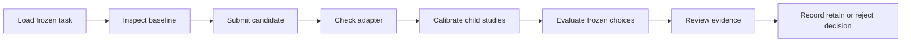

# Part 1 investigation plan

Determine how Autoengineering should coordinate agents while retaining control of scientific
execution, acceptance, budgets, and evidence. Use one bounded Leaf River task to compare a plugin
for an existing agent harness with a small standalone orchestrator. Assess a dedicated harness
against the requirements those prototypes cannot satisfy.

This expands [Part 1 of the development plan](../development-plan.md#1-investigate-the-architecture-through-one-complete-workflow).
The outcome is an architecture decision backed by executable evidence and a concrete handoff to
Part 2. The initial preference for a portable orchestrator and plugin is a hypothesis to test.

__Status:__ complete for the development handoff. The user accepted the evidence as sufficient
to proceed and deferred strict token enforcement and other-model support. The recorded
[results and gate status](../../background-research/agentic-architecture/README.md) retain the failed
and untested checks. The [Part 2 implementation plan](../implementation-plans/part-2-workflow-contracts.md)
defines the current scope; host integration and agent roles follow in Part 3.

## Decisions and scope

Answer these questions before choosing the implementation:

| Question | Evidence needed |
| --- | --- |
| What must Autoengineering own? | A responsibility map covering workflow state, candidate admission, execution, acceptance, budgets, and recovery |
| Can an existing harness coordinate the workflow reliably? | A complete Leaf River run, structured handoffs, cancellation, and restart tests through one host integration |
| What does a standalone orchestrator add? | The same task through a second control path, with measured differences in recovery, integration effort, and operating cost |
| Can workers and hosts be exchanged? | A second host completing the same tool contract without changes to scientific code or record formats |
| Which reference-system ideas transfer? | Source-backed design notes and small executable checks of the mechanisms selected for adoption |
| What would justify a dedicated harness? | A reproducible requirement failure in both simpler approaches, plus a bounded estimate of the custom work needed |

Part 1 includes enough prototype code to test these questions. The general campaign schema,
production multi-agent system, broad model DAG redesign, optimizer integrations, and utility
benchmarks belong to later parts. Record requirements for those parts as they emerge.

Architecture success means that the workflow produces a correct, recoverable decision. A decision
to retain the baseline is a successful architecture outcome. Scientific improvement and reduced
human effort remain separate measurements.

## Starting evidence from the repository

The current code provides useful pieces, but the Leaf River example needs preparation before it
can serve as the architecture test.

| Existing piece | Observed behavior | Investigation consequence |
| --- | --- | --- |
| [Leaf River example](../../examples/leaf_river/README.md) | Uses cached 2019-2020 streamflow and weather; candidate selection uses the comparison record | Define chronological development splits and record prior exposure to both years |
| [Automated workflow](../../examples/leaf_river/run_auto_research.py) | Runs supplied candidates; contains soil, recharge, and wiring logic outside the YAML graph | Include this arithmetic and its source identity in the task contract |
| [Routing alternative](../../examples/leaf_river/models/routing_calibrated.py) | Supplies fixed parameter defaults under a calibrated name | Establish a recorded calibration procedure rather than treating the name as fitting evidence |
| [Routing wrappers](../../examples/leaf_river/models/routing_runnable.py) | Expose two array inputs and use model defaults | Prototype an adapter that also exposes the declared calibration parameters |
| [Manual diagnostics](../../examples/leaf_river/run_workflow.py) | Compare PET against another method and runoff against a partition derived from streamflow | Label these as proxy diagnostics; do not treat them as independent component observations |
| [Replacement loop](../../src/autoengineering/research/loop.py) | Retains by its fitness rule; thresholds annotate results; it lacks durable study recovery | Keep the architecture experiment's acceptance decision explicit and outside legacy retention semantics |
| [Optimization controller](../../src/autoengineering/optimization/controller.py) | Provides immutable study identity, explicit failures, budgets, and recovery | Reuse a bounded child study for numerical calibration and investigate the campaign-to-study boundary |

The recent wiring and copy-semantics fixes are part of the starting checkout. Pin the actual source
revision and dependency lock when the investigation begins, including any subsequent changes.

## Work package 1: Audit the development task

Trace the Leaf River workflow from cached bytes to the final score. Produce a compact execution
map identifying inputs, unit conversions, date alignment, hidden arithmetic, model state,
parameters, metrics, and generated artifacts. Compare that map with the declared graph.

Inspect the following before choosing the task:

- Data identity: cache hashes, gage and weather-station metadata, drainage-area conversion, time
  coverage, missing values, duplicate dates, quality flags retained or lost, and station/basin
  spatial mismatch. Identify assumptions that require checking against the original providers.
- Time handling: whether dropping missing rows compresses gaps in models that assume daily steps,
  whether initial conditions affect scoring, and how state carries across split boundaries.
- Model accounting: soil storage, runoff partitioning, recharge, baseflow, and truncated routing
  tails. Determine which component invariants can be checked and whether a complete system water
  balance can actually be reconstructed.
- Selection history: where existing candidate defaults came from, which periods informed them,
  and which published example scores are reproducible with the current code.
- Execution behavior: deterministic repeatability, source-array isolation, process lifetime,
  output collisions, import paths, and failure reporting.

Run the baseline only in a fresh investigation output directory. Capture its configuration,
arrays, metrics, timings, and environment. Reconstruct the metrics independently from saved
arrays. Avoid using the existing example's shared output directory for new evidence.

__Deliverables:__ `baseline-audit.md`, `execution-map.md`, and a hashed baseline artifact manifest.

__Gate A:__ the data and numerical path are understandable and repeatable. If defects prevent a
meaningful routing comparison, record the smallest prerequisite repair. If the chain cannot support
the required scientific checks within the investigation budget, retain it only as an orchestration
fixture and select a suitable existing hydrology example for scientific acceptance. Do not quietly
weaken a physical constraint to admit the baseline.

## Work package 2: Freeze one bounded modeling task

Use routing replacement as the initial task, subject to Gate A. Hold weather inputs, PET, soil
moisture, runoff, and graph topology fixed. Compare the triangular routing family with the supplied
gamma routing family. This exercises a structural choice and an inner calibration while keeping
the scientific search small enough to inspect.

The task presented to an agent should ask it to inspect baseline diagnostics, explain whether a
routing intervention is justified, prepare the supplied alternative's adapter, request calibration,
and recommend retention or rejection from returned evidence. A negative recommendation is allowed.
The first pass supplies the candidate implementation and a fixed source packet. Open-ended model
invention and live literature search would introduce additional variation before the integration
contract is understood.

Freeze a versioned task specification containing:

| Field | Required decision |
| --- | --- |
| Task identity | Source revision, input hashes, environment, task version, and model identities |
| Allowed intervention | Routing family and explicitly named parameters; permitted candidate workspace and dependencies |
| Data split | Exact fitting and comparison timestamps, warm-up mask, missing-day policy, and state initialization |
| Calibration | Objective, parameter bounds, seed, policy, evaluation limit, and treatment of failed calls |
| Acceptance | Hard executable checks, comparison metric, minimum gain, allowed secondary-metric degradation, and tie rule |
| Access | Data and artifacts visible to each role, writable paths, evaluator boundary, and network policy |
| Resources | Evaluation, time, retry, tool-call, token, and monetary limits where applicable |
| Outputs | Required candidate, calibration, evaluation, decision, and provenance records |

Use 2019 for fitting and 2020 for development comparison as the starting split proposal. Finalize
it after the data and state audit. Both years have already been used in repository development,
so this split provides a controlled engineering exercise, not independent confirmation of predictive
skill. Future confirmation needs new tasks or observations reserved before development.

For stateful evaluation, run causal model state forward using permitted forcing data and score
only the declared timestamps. Do not reset state arbitrarily at a boundary or feed comparison-period
streamflow into calibration. Bind preprocessing fitted on data to the fitting period. Keep comparison
observations outside the worker workspace and expose them only through the evaluator's allowed
results. Because the original CSVs are in the repository, a prompt asking an agent to ignore them
does not establish this boundary; use a staged workspace with controlled file access.

Fit both routing families with the same declared numerical policy and budget. Start with Sobol or
another existing deterministic baseline policy to keep optimizer research out of this comparison.
Record default-model performance as well as the calibrated comparison, so structural benefit is
not confused with additional parameter fitting. The current wrappers will need a small, explicit
parameter adapter for this experiment.

Use streamflow RMSE as the provisional fitting objective, with NSE, KGE, and bias reported alongside
it. Choose numeric acceptance tolerances after the audit and before comparing architectures.
Hard checks should cover finite aligned outputs, valid parameters, nonnegative flow where justified,
causality, and the component accounting established at Gate A. Full-system conservation can be a
hard check only when the requisite states and fluxes are represented. Separate a scientific failure
from a crash or an unavailable check.

__Deliverables:__ `task.yaml`, `acceptance.md`, a staged input manifest, and a deterministic reference
driver that runs the task without an LLM.

__Gate B:__ the reference driver produces a decision from executable rules, every limit and
tolerance has a concrete value, and a deliberately invalid candidate is rejected. Freeze the task
before host comparisons. Revisions create a new task version and require new comparable runs.

## Work package 3: Investigate reference systems and available harnesses

Use the [landscape review](../../background-research/similar-tools/agentic-tools-landscape.md) to
bound the investigation. Start with three implementation studies and expand only to resolve a
specific unanswered question:

| Reference | Questions to trace through code and documentation |
| --- | --- |
| Modelica commissioning-agent study | Who defines acceptance? How are physical checks, unseen cases, generated artifacts, and agent access separated? |
| G-Sim, with SGA as an alternative | Where does structural proposal end and calibration begin? How are candidate code, parameters, feedback, and lineage connected? |
| TusoAI, with SOCIA-EVO as an alternative | How are budgets, candidate history, repair attempts, worker execution, and continuation represented? |

For each, record the exact revision, license, dependency requirements, important entry points,
control flow, persisted artifacts, and recovery behavior. Label evidence as documented, inspected
in code, or executed. Trace a small path or run an affordable official example when it answers a
design question. An inaccessible or costly dependency is an access limitation, not evidence that
the mechanism fails. Avoid taking reported performance on unrelated tasks as a comparative score.

For each transferable idea, write a short adoption note: the problem it solves, the smallest
Autoengineering implementation, dependencies and attribution, and the test that could falsify its
usefulness. Include a reject or defer decision when a mechanism adds complexity without serving
the frozen task.

Inventory the coding-agent harnesses available for the investigation. Check their current official
interfaces and installed versions for structured tools, noninteractive worker invocation, role
delegation, context limits, cancellation, transcripts, permissions, and provider configuration.
Select one primary host and one portability target. Do not infer a capability from a product name
or from a generic claim of MCP support.

__Deliverables:__ `reference-findings.md`, `host-capabilities.csv`, and a shortlist of mechanisms
to prototype. Each finding links to source evidence or a saved execution record.

__Gate C:__ the primary host can exercise the task contract, and a plausible second host exists.
Any missing capability has an explicit consequence for the architecture comparison.

## Work package 4: Define the prototype boundaries

Write a responsibility map before implementing either route:

| Responsibility | Proposed owner |
| --- | --- |
| Research, explanation, candidate preparation, and critique | Agent roles invoked by the chosen host or orchestrator |
| Legal task transitions, budget reservations, candidate admission, and final retention | Autoengineering control code |
| Parameter suggestions and numerical calibration | Existing optimization child study |
| Model execution and resource isolation | Execution adapter and its selected process or sandbox boundary |
| Metric calculation and scientific acceptance | Evaluator with protected configuration and comparison data |
| Durable scientific state | Autoengineering records, with links to host transcripts and child-study artifacts |

Keep the physical graph, agent task dependencies, and experiment lineage distinct. Determine which
existing records can be referenced directly and which small campaign-level record is missing.
Document how `Candidate.name`, which identifies the replacement target today, relates to a unique
candidate version. Bind imported model source and hidden glue code as well as the top-level
evaluator; do not assume a top-level file hash covers every dependency.

Sketch a minimal tool contract for loading task state, reading allowed diagnostics, submitting a
candidate, requesting calibration/evaluation, inspecting results, and recording a recommendation.
Define schema validation, artifact references, request identity, allowed state transitions, errors,
and cancellation. Treat CLI/JSON as the initial transport candidate. Test whether MCP or a host
plugin materially simplifies the integration without changing the scientific contract.

Specify the handoff between campaign recovery and the existing study controller. An interrupted
agent should reconstruct its next task from durable state. A restarted calibration should use the
same compatible child study. A changed candidate implementation creates a new identified study.
Distinguish one committed result from one physical execution: a crash can leave computation with
an uncertain outcome, which needs reconciliation and honest cost accounting.

__Deliverables:__ `responsibilities.md`, example request/result records, and a short recovery-state
diagram. These are prototype contracts to refine in Part 2, not a new general framework.

__Gate D:__ an agent can request work and read evidence without directly editing acceptance rules,
scientific ledgers, or comparison observations. A deterministic worker stub can traverse the contract.

## Work package 5: Build two comparable prototypes

Implement the smallest complete path for each option:

| Option | Prototype | Question answered |
| --- | --- | --- |
| A: Existing harness plugin | Host coordinates bounded role calls through Autoengineering tools; durable task state stays outside the chat session | Can the existing host supply enough orchestration with little custom code? |
| B: Standalone orchestrator | A local control process dispatches the same roles to an interchangeable worker adapter and uses the same tools | Does explicit scheduling improve recovery, control, or portability enough to justify its maintenance? |
| C: Dedicated harness | Written design and requirement-gap analysis; implement a small spike only for a demonstrated missing capability | Is ownership of model calls, context, tool execution, and runtime actually necessary? |

Use the same task, supplied candidate, evaluator, calibration policy, role instructions, and budget
for A and B. Use the same model and worker runtime where possible. Record unavoidable differences
and avoid attributing model-quality differences to the orchestration architecture.

Exercise investigator, implementer, and reviewer handoffs serially. The investigator produces a
testable rationale, the implementer prepares the bounded adapter, and the reviewer checks the
returned evidence. Role separation here tests delegation and artifacts. Its scientific value is
tested later against a single agent in Part 3.

Begin with deterministic recorded worker responses to isolate transport and control behavior.
Then use live workers to verify that the role handoffs are usable. Every clean execution should
reach the following path:

Make the final report from recorded results, including failed and rejected attempts. Trace every
numeric statement to an artifact. Have the second host run the same deterministic contract and
one live bounded handoff when available. Record separately whether portability was demonstrated
with a stub, a real worker, or the full task.

__Deliverables:__ executable sketches, commands to reproduce them, transcripts, canonical result
records, and an integration-effort log. Keep prototypes in a dedicated investigation directory.

__Gate E:__ both implemented routes reach a valid recorded decision, or a concrete blocker explains
why one cannot. A replayable supplied-candidate path is mandatory for completing Part 1. Broader
portability remains unproven if the second host cannot be exercised.

## Work package 6: Test recovery, boundaries, and cost

Run the following cases against both routes. Use small deterministic fixtures for most failures
and repeat critical execution/recovery boundaries with the real Leaf River evaluator.

| Case | Required behavior |
| --- | --- |
| Wrong output shape, missing output, or nonfinite array | Visible candidate/model failure; no eligible recommendation |
| Numerically attractive but scientifically invalid output | Acceptance rejects it and retains the failed checks |
| Malformed or unsupported agent request | Rejected before execution, with a usable error and bounded retry |
| Duplicate evaluation request | Same request identity reconciles to one logical result; no silent extra budget |
| Worker disappears before submitting its candidate | Campaign resumes from the last durable transition |
| Process stops after evaluation but before acknowledgment | Saved result is reconciled, or uncertain execution is recorded explicitly |
| Cancellation or exhausted budget | New work stops; active children follow the declared termination policy; costs remain visible |
| Changed source, inputs, or task on resume | Incompatible continuation is rejected without rewriting prior evidence |
| Candidate attempts to read protected data or alter evaluator records | Access is denied by the selected execution boundary |
| Concurrent or stale writes | One authoritative writer accepts a valid transition; conflicting work is rejected or reconciled |
| Unsupported scientific conclusion in an agent report | Report checks expose the mismatch with measured evidence |

A prompt, separate role, or ordinary child process alone does not prove isolation. Record the actual
permissions and filesystem boundary tested. Keep source-inspection access for research separate
from permissions granted to executable candidate code.

For transport parity, replay the same admitted candidate snapshot through the reference driver,
A, and B. Declare volatile fields such as timestamps, run IDs, and host trace IDs in advance.
Require identical task and candidate identities, scientific statuses, numerical choices, and
evaluation counts. Set numeric tolerances from direct repeated execution in the same environment.
If a live implementer produces a different adapter, check that exact snapshot against the reference
driver before comparing it. Record differences in agent behavior and cost separately from transport
parity. Do not require identical LLM prose or assume a seed makes a hosted model fully deterministic.

Measure setup effort, custom code, external dependencies, task completion, manual interventions,
recovery time, total wall time, numerical execution time, token use, tool calls, and monetary cost
when observable. Report missing cost information as unknown. Track unsuccessful attempts and repair
time. Compare orchestration overhead separately from scientific calculation time.

__Deliverables:__ `test-matrix.csv`, failure traces, `runs.csv`, and `comparison.md`, with links to
the exact artifacts behind each entry.

__Gate F:__ the recommended route passes every mandatory boundary and recovery check. A failed
mandatory check cannot be offset by lower cost or better average task completion.

## Work package 7: Choose the architecture and prepare the handoff

Evaluate mandatory requirements first: executable evidence, correct acceptance, protected data and
records, bounded resources, recoverable state, and compatible child-study identity. Mark each
pass, fail, or not tested. An untested mandatory requirement prevents an unconditional recommendation.

For routes that pass, compare maintenance burden, integration effort, host/model portability,
observability, human intervention, and measured operating cost. Show the raw measurements and
tradeoffs rather than hiding them in one weighted score. Prefer the least complex route that meets
the requirements. If the result depends on uncertain estimates, name the additional experiment
that would change the choice.

A dedicated harness is justified only by a named requirement that the two simpler designs cannot
meet economically, supported by the failed prototype or interface evidence. Estimate the added
work for model invocation, tool execution, context management, permissions, cancellation, logging,
and upgrades. A preference for more control is insufficient by itself.

Write the architecture decision with the chosen route, rejected alternatives, evidence, unresolved
limitations, dependency and license implications, and conditions for revisiting the decision.
Provide a Part 2 backlog ordered by dependency: task/campaign contract, adapter semantics, identity,
acceptance, recovery, then host integration. Identify which prototype pieces should be retained,
rewritten, or discarded.

__Gate G:__ the decision, frozen task specification, and replayable candidate-to-decision sketch
are complete. Part 1 may conclude that further evidence is needed; it must not label an unresolved
architecture choice as settled.

## Sequence, limits, and outputs

Run work packages 1 and 2 first. Reference and host investigation can proceed alongside the task
audit. Define responsibilities after both have supplied enough evidence. Build and test the
prototypes only after the task is frozen, then write the decision from those results.

Use the following proposed limits to bound the pilot. Finalize them after the baseline timing
check and record them before comparative runs:

- Inspect three reference implementations in depth, plus at most one alternative if a source is
  unavailable or fails to answer its assigned question.
- Implement two architecture routes, one primary worker host, and one portability target.
- Use one supplied structural candidate and one numerical calibration policy. Start with at most
  16 parameter evaluations for each routing family, with defaults included in those counts.
- Run three clean live executions of each route. Cap each at 40 scientific system executions,
  30 minutes, and two repairs of an agent handoff. These are operability observations, not enough
  repetitions for a general performance claim.
- Reserve at most 80 additional scientific executions for the reference driver, preflight,
  portability, and real failure/recovery checks. The six clean executions plus this allowance give
  a ceiling of 320 system executions. Count attempted and failed executions, including any worker
  smoke runs; use fixtures or saved results for the remaining fault matrix and transport replays.
- Freeze token and monetary limits after selecting the worker model and checking its accounting
  interface. No live model pilot starts with those applicable limits left unspecified.

Stop a route when it violates a mandatory boundary. Retain the failure, repair under a new recorded
revision, and rerun the affected checks within the remaining budget. Stop expanding the design when
the decision is supported or the investigation limit is reached. Carry unanswered questions into
the decision record instead of allowing the prototype to grow into a production implementation.

Store future outputs under `background-research/agentic-architecture/`, with an index linking the
audit, task specification, reference findings, responsibility map, comparison, and decision. Keep
executable sketches under `examples/agentic_architecture_pilot/` and individual run artifacts in
fresh output directories. Record source and environment hashes with every run. Preserve the checked
BO benchmarks and their existing gates.

Before handoff, verify the reproduction commands, artifact links, and numeric report values. Run
focused contract tests and the default lint/test suite for prototype code that changes package
behavior. Report the platforms actually exercised. A successful completion claim should identify
the selected architecture, its passing evidence, its limits, and the exact next implementation
step.
