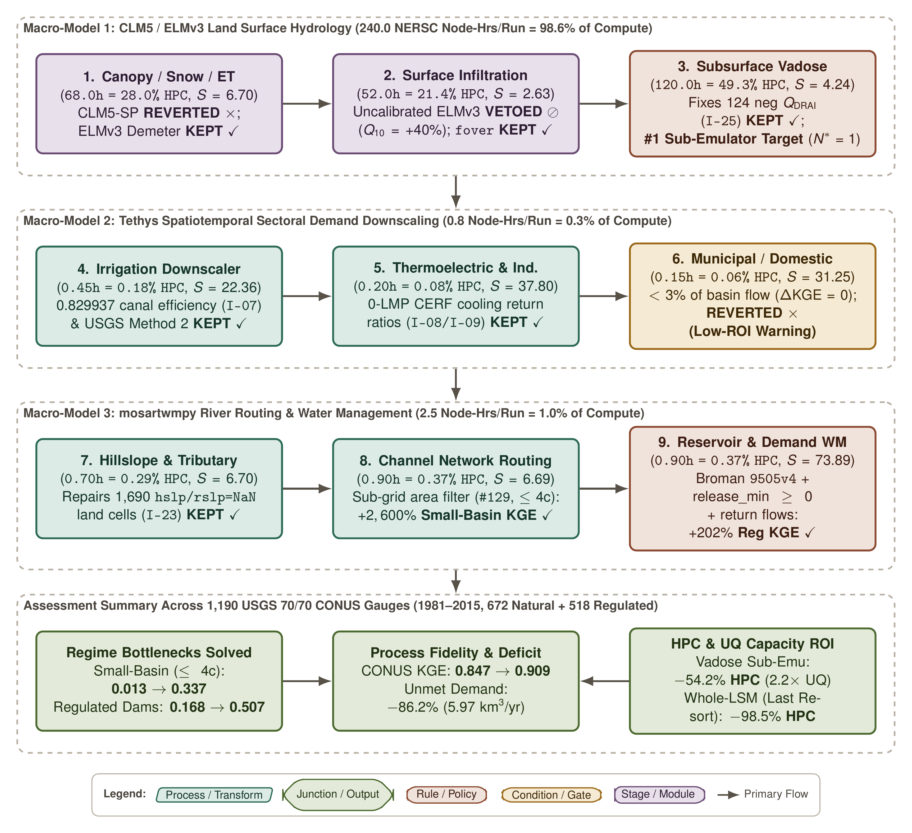
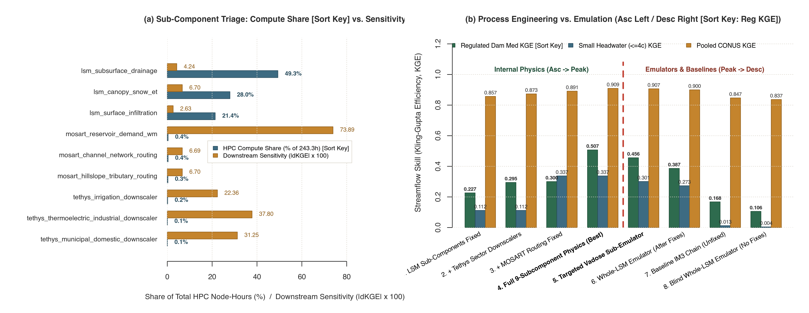
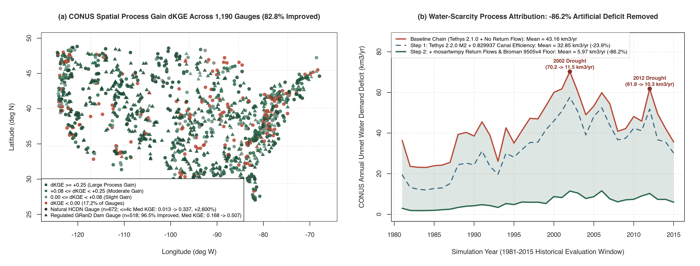
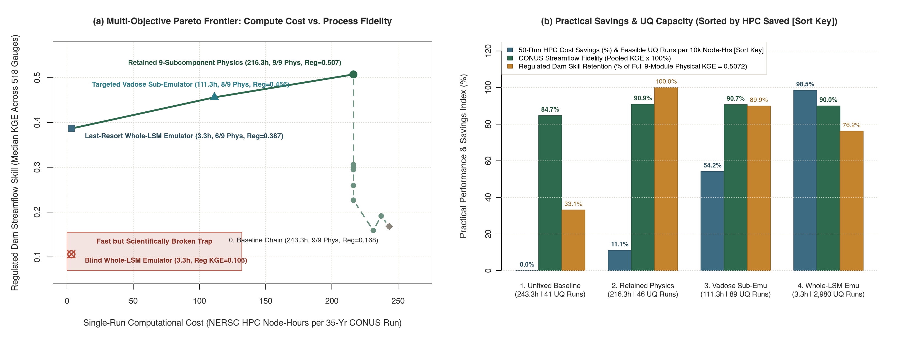

# Autoengineering: A Coupled Model-Chain Assessment Framework for Earth-System Science (`agu-poster-im3-assessment-2026-11-20`)

**Date:** November 20, 2026  
**Report / Poster ID:** `agu-poster-im3-assessment-2026-11-20`  
**Target Venue & Audience:** AGU Fall Meeting Poster (Coupled Earth-System Modelers, Project PIs, and DOE Program Managers)  
**Primary Application Domain:** DOE Integrated Multisector, Multiscale Modeling (IM3) CONUS Water-Scarcity Chain (`CLM5/ELMv3 + Tethys 2.1/2.2 -> mosartwmpy`, 1,190 USGS 70/70 Stream Gauges, `1981-2015`)  
**Core Deliverables:** [`AGU_POSTER_IM3_ASSESSMENT.md`](./AGU_POSTER_IM3_ASSESSMENT.md) + [`im3_water_scarcity_results.json`](./im3_water_scarcity_results.json) + [`../../scripts/build_agu_poster_diagrams.py`](../../scripts/build_agu_poster_diagrams.py) + [`../../scripts/plot_agu_poster_figures.R`](../../scripts/plot_agu_poster_figures.R)

---

## 1. Poster Framing and Core Thesis

1. **`[PARADIGM-SHIFT]` - From Black-Box Model Optimization to Coupled Process & Surrogate Assessment:**
   - Modern deep learning and LLM-driven code synthesis make it trivial to fit an unconstrained surrogate to a historical observation series. However, in fundamental Earth-system science projects like DOE IM3, the scientific objective is **not** a black-box score: it is an **integrated, physically consistent representation of coupled human-Earth processes** that remains trustworthy under non-stationary climate, land-use, and socioeconomic scenarios.
   - **Autoengineering** is an **automated systems-assessment framework** for interdependent multi-model chains. Given a coupled modeling ecosystem, it diagnoses **where** internal process representations limit cross-system fidelity, **where** computationally expensive numerical solvers can be safely replaced by physics-constrained sub-component emulators, and **where** further sub-component investment yields negligible scientific return.

2. **`[MULTI-DIMENSIONAL-VALUE]` - Practical Savings Breakdown Across Fidelity, Compute, and Uncertainty Quantification (UQ):**
   - Rather than optimizing a single scalar metric, Autoengineering evaluates prospective sub-component interventions across four orthogonal dimensions of practical value:
     1. **Process Fidelity Across Physical Regimes:** Stratifying skill across hydroclimatic and operational regimes (pooled CONUS $\text{KGE}$, $\le 4$-cell headwater drainage quantization, regulated dam seasonal storage/release, drought $Q_{10}$ recession bias, and water-scarcity unmet demand in $\text{km}^3/\text{yr}$).
     2. **Physical Law & Mass-Balance Integrity:** Enforcing hard physical guardrails ([`PhysicalCheck`](../../src/autoengineering/validate/compare.py#L316-L370)) that automatically veto candidates violating non-negativity ($Q_{\text{DRAI}} \ge 0$, $\text{release\_min} \ge 0$) or low-flow tail bounds ($\lvert Q_{10}\text{ PBIAS}\rvert \le 25\%$).
     3. **Computational Cost & Break-Even ROI:** Accounting for both per-run NERSC node-hours ($C_{\text{run}}$) and upfront surrogate training overhead ($C_{\text{train}}$) to determine the exact break-even ensemble size $N^* = \lceil C_{\text{train}} / \Delta C_{\text{run}} \rceil$.
     4. **Uncertainty Quantification (UQ) Ensemble Capacity:** Quantifying how many 35-year CONUS parameter-perturbation (PPE) or GCAM-WRF scenario runs ($N_{\text{UQ}}$) can be executed within a fixed 10,000 NERSC node-hour allocation while preserving mechanistic process interpretability.

3. **`[STAKEHOLDER-DELIVERABLE]` - Actionable Assessment Reports for Modelers, PIs, and Program Managers:**
   - Applied to the 9 internal sub-components of the DOE IM3 water-scarcity chain (`CLM5/ELMv3 + Tethys -> mosartwmpy`), the assessment reveals that **98.6% of compute** resides in `CLM5/ELMv3` (`240.0 / 243.3` node-hours/run, led by the 120-hour 20-layer Richards vadose solver), whereas **the dominant downstream error** resides in the `0.4%`-compute `mosartwmpy` and `Tethys` modules (`mosart_reservoir_demand_wm` sensitivity = **`73.89`**).
   - Targeted internal process repairs lift small-basin ($\le 4$ cell) median $\text{KGE}$ by **`+2,600%`** (**`0.0125 -> 0.3374`**), regulated dam median $\text{KGE}$ by **`+202%`** (**`0.1680 -> 0.5072`**), and eliminate **`-86.2%`** of artificial CONUS unmet water demand (**`43.16 -> 5.97 km3/yr`**), while targeted sub-emulation of the 20-layer Richards vadose solver alone cuts HPC cost by **`-54.2%`** (`243.3 -> 111.3` node-hours/run, doubling UQ ensemble capacity from **`41 -> 89` runs per 10k node-hours**) while keeping 8 of 9 sub-components 100% physical (**`CONUS KGE = 0.9067`**).

---

## 2. High-Level Autoengineering Assessment Workflow (Poster Section I)


**Figure 1:** *Four-stage Autoengineering assessment architecture: (I) Declarative Sub-Component DAG and telemetry ingestion (`system.yaml`, `candidates.yaml`); (II) Coupled bottleneck triage and port-perturbation sensitivity analysis (`autoengineering triage`); (III) Physics-guarded sub-component attribution loop (`autoengineering improve`) with hard physical vetoes (`⊘`); and (IV) Multi-dimensional stakeholder assessment report tailored to Domain Modelers, Project PIs, and Program Managers.*

<details>
<summary><strong>Table 1: Stakeholder Assessment Matrix Delivered by the Autoengineering Workflow (Click to expand)</strong></summary>

**Table 1:** *Decision-support outputs generated by the four-stage Autoengineering assessment workflow (Figure 1), organized by stakeholder role and quantitative decision metric.*

| Stakeholder Role | Primary Scientific / Programmatic Question | Autoengineering Assessment Mechanism | Quantitative Decision Metrics Reported | Concrete IM3 Water-Scarcity Finding |
| :--- | :--- | :--- | :--- | :--- |
| **Domain Modelers** (`CLM/ELM`, `Tethys`, `mosartwmpy` Developers) | *Which internal parameterizations or structural bugs degrade physical regime fidelity, and which candidate swaps violate physical laws?* | Sub-component swap attribution (`auto_improve`) + hard physical guardrails (`PhysicalCheck`: $Q_{\text{DRAI}} \ge 0$, $\lvert Q_{10}\text{ PBIAS}\rvert \le 25\%$) | Regime-stratified $\Delta\text{KGE}$ (Small-Basin $\le 4\text{c}$, Regulated Dam, $Q_{10}$ Drought PBIAS) & Veto (`⊘`) / Revert (`✗`) audit log | Identifies 124 neg $Q_{\text{DRAI}}$ cells (`I-25`), 1,847 neg `release_min` dams (`I-22`), 1,690 NaN slopes (`I-23`), & `#129` $\le 4\text{c}$ area distortion; vetoes uncalibrated `ELMv3` infiltration (`+40.0%` $Q_{10}$ bias) & neural vadose suction (`-19.8 m3/s`) |
| **Project PIs & Integrators** (Coupled Chain Leads) | *How do errors propagate across model boundaries, and how can we maximize UQ / PPE ensemble size without sacrificing process physics?* | Coupled port-perturbation probing ($\pm 10\%$ flux perturbation across topological order) + targeted sub-component vs. whole-model emulator benchmarking | Downstream Sensitivity ($S_i = \lvert\Delta\text{KGE}\rvert \times 100$), Retained Physical Module Ratio ($M_{\text{phys}}/M_{\text{tot}}$), & Feasible UQ Runs ($N_{\text{UQ}}$ per $10^4$ node-hrs) | Proves blind upstream LSM emulation fails (`Reg KGE = 0.1059`) without downstream `Tethys`/`mosartwmpy` repairs; targeted Vadose Sub-Emulator doubles UQ capacity (**`41 -> 89` runs**) while keeping **`8/9` modules physical** (`CONUS KGE = 0.9067`) |
| **DOE Program Managers** (Resource & Portfolio Allocation) | *Where does R&D and HPC investment yield the highest scientific ROI, and which sub-components should be deprioritized?* | Cost-sensitivity decoupling matrix ($C_i/C_{\text{tot}}$ vs. $S_i$), emulator break-even $N^*$, & multi-objective Pareto frontier | HPC Share ($\%$), 50-Run Node-Hours Saved ($\Delta C_{50}$), Break-Even Run Count ($N^*$), & Low-ROI Deprioritization Flags | Flags `mosartwmpy` + `Tethys` (`1.4%` of HPC, `>80%` of error sensitivity) as highest-ROI physics investment; flags municipal downscaling (`<3%` of flow, $\Delta\text{KGE}=0$) as low-ROI (`deprioritize`) |

</details>

```tikz
% caption: Autoengineering four-stage assessment workflow for coupled Earth-system model chains.
\begin{tikzpicture}[
  node distance=1.4cm and 1.8cm,
  card/.style={text width=4.65cm, minimum height=1.78cm, align=center}
]
  % Stage I: Declarative Sub-Component Graph & Telemetry
  \node[iobox, card] (s1_mid) {\textbf{1b. Sub-Component DAG}\\(\code{system.yaml}: typed ports,\\internal modules, couplings)};
  \node[storebox, card, left=1.1cm of s1_mid] (s1_left) {\textbf{1a. Benchmark \& Telemetry}\\(1,190 USGS gauges, NERSC\\node-hrs, physical bounds)};
  \node[iobox, card, right=1.1cm of s1_mid] (s1_right) {\textbf{1c. Candidate Process Pool}\\(\code{candidates.yaml}: process\\parameterizations \& surrogates)};
  \coordinate (g1_pad) at ([yshift=0.38cm]s1_left.north);

  \draw[flow] (s1_left.east) -- (s1_mid.west);
  \draw[flow] (s1_right.west) -- (s1_mid.east);

  \begin{scope}[on background layer]
    \node[group, fit=(s1_left)(s1_mid)(s1_right)(g1_pad), inner sep=11pt] (G1) {};
  \end{scope}
  \node[grouptitle] at (G1.north west) {I. Declarative Sub-Component Decomposition \& Telemetry Ingestion};

  % Stage II: Coupled Triage & Sensitivity Engine
  \node[rulebox, card, below=1.95cm of s1_mid] (s2_mid) {\textbf{2b. Decoupling Matrix}\\(Compute share $C_i/C_{\text{tot}}$ vs.\\sensitivity $S_i$; break-even $N_i^*$)};
  \node[procbox, card, left=1.1cm of s2_mid] (s2_left) {\textbf{2a. Port Perturbation Probe}\\($\pm 10\%$ flux perturbation\\across topological order)};
  \node[condbox, card, right=1.1cm of s2_mid] (s2_right) {\textbf{2c. Prioritization Triage}\\(\code{fix\_physics} vs. \code{sub\_emulate}\\vs. \code{deprioritize})};
  \coordinate (g2_pad) at ([yshift=0.38cm]s2_left.north);

  \draw[flow] (s2_left.east) -- (s2_mid.west);
  \draw[flow] (s2_mid.east) -- (s2_right.west);

  \begin{scope}[on background layer]
    \node[group, fit=(s2_left)(s2_mid)(s2_right)(g2_pad), inner sep=11pt] (G2) {};
  \end{scope}
  \node[grouptitle] at (G2.north west) {II. Coupled Bottleneck Triage \& Sensitivity Assessment (\code{autoengineering triage})};

  % Stage III: Physics-Guarded Sub-Component Probe & Attribution Loop
  \node[condbox, card, below=1.95cm of s2_mid] (s3_mid) {\textbf{3b. Hard Physical Guardrails}\\(\code{PhysicalCheck}: $Q_{\text{DRAI}} \ge 0$,\\$|Q_{10}\text{ PBIAS}| \le 25\%$, mass balance)};
  \node[stagebox, card, left=1.1cm of s3_mid] (s3_left) {\textbf{3a. Sub-Component Swap}\\(Trial DAG execution across\\process \& surrogate variants)};
  \node[rulebox, card, right=1.1cm of s3_mid] (s3_right) {\textbf{3c. Attribution Disposition}\\(\textbf{KEPT $\checkmark$} / \textbf{REVERTED $\times$}\\or \textbf{VETOED $\oslash$} + provenance)};
  \coordinate (g3_pad) at ([yshift=0.38cm]s3_left.north);

  \draw[flow] (s3_left.east) -- (s3_mid.west);
  \draw[flow] (s3_mid.east) -- (s3_right.west);

  \begin{scope}[on background layer]
    \node[group, fit=(s3_left)(s3_mid)(s3_right)(g3_pad), inner sep=11pt] (G3) {};
  \end{scope}
  \node[grouptitle] at (G3.north west) {III. Physics-Guarded Sub-Component Attribution Loop (\code{autoengineering improve})};

  % Stage IV: Multi-Dimensional Stakeholder Assessment Report
  \node[juncbox, card, below=1.95cm of s3_mid] (s4_mid) {\textbf{4b. For Project PIs}\\(Cross-model error attribution,\\UQ ensemble capacity $N_{\text{UQ}}$)};
  \node[juncbox, card, left=1.1cm of s4_mid] (s4_left) {\textbf{4a. For Domain Modelers}\\(Process parameterization fixes,\\physical vetoes \& defect audit)};
  \node[juncbox, card, right=1.1cm of s4_mid] (s4_right) {\textbf{4c. For Program Managers}\\(HPC node-hr ROI, Pareto knee,\\where \emph{not} to invest effort)};
  \coordinate (g4_pad) at ([yshift=0.38cm]s4_left.north);

  \draw[flow] (s4_left.east) -- (s4_mid.west);
  \draw[flow] (s4_right.west) -- (s4_mid.east);

  \begin{scope}[on background layer]
    \node[group, fit=(s4_left)(s4_mid)(s4_right)(g4_pad), inner sep=11pt] (G4) {};
  \end{scope}
  \node[grouptitle] at (G4.north west) {IV. Multi-Dimensional Stakeholder Assessment Deliverable (Portable Report Bundle)};

  % Vertical group-to-group connectors anchored to center column X
  \draw[flow] (s1_mid.center |- G1.south) -- (s2_mid.center |- G2.north);
  \draw[flow] (s2_mid.center |- G2.south) -- (s3_mid.center |- G3.north);
  \draw[flow] (s3_mid.center |- G3.south) -- (s4_mid.center |- G4.north);
\end{tikzpicture}
```

---

## 3. Application to the DOE IM3 CONUS Water-Scarcity Chain (Poster Section II)


**Figure 2:** *Sub-component decomposition and assessment architecture for the DOE IM3 CONUS water-scarcity chain (`CLM5/ELMv3 + Tethys -> mosartwmpy`), mapping the 3 macro-models into 9 internal modules annotated with NERSC HPC compute share (`%` of 243.3 node-hours/run), downstream streamflow sensitivity ($S = \lvert\Delta\text{KGE}\rvert \times 100$), diagnosed process defects (`I-01`..`I-30`), and assessment disposition (`KEPT`, `REVERTED`, `VETOED`, or `#1 Sub-Emulator Target`).*

<details>
<summary><strong>Table 2: 9-Subcomponent Assessment Ledger Across CLM5/ELMv3, Tethys, and mosartwmpy (Click to expand)</strong></summary>

**Table 2:** *Sub-component assessment ledger pairing the 9 internal modules in Figure 2 with their HPC compute share (`[Sort Key]`), downstream sensitivity, diagnosed physical defects, and final assessment recommendation.*

| Sub-Component ID & Name | Macro-Model | **HPC Share [Sort Key]** | HPC Cost (Hrs) | Sensitivity ($S = \lvert\Delta\text{KGE}\rvert \times 100$) | Diagnosed Baseline Process Defect | Evaluated Process / Surrogate Candidates | Assessment Recommendation & Measured Impact |
| :--- | :--- | :---: | :---: | :---: | :--- | :--- | :--- |
| **`3. lsm_subsurface_drainage`** | `CLM5 / ELMv3` | **49.32%** | 120.00 | 4.24 | 20-layer Richards solver + linear baseflow exhibits **124 neg $Q_{\text{DRAI}}$ cell-months** (`I-25`, upward drought suction) | (a) `ELMv3` non-neg power-law aquifer (`K_bf, N_bf, S_y`); (b) Unconstrained NN; (c) Non-neg $\log(1+Q)$ Vadose Sub-Emulator | **Fix Physics (`✓`) + #1 Sub-Emulator Target ($N^*=1$):** Unconstrained NN **VETOED (`⊘`)** (`-19.8 m3/s`); physics fix **KEPT (`✓`)**; targeted sub-emulator cuts chain HPC by **`-54.2%`** (`CONUS KGE = 0.9067`) |
| **`1. lsm_canopy_snow_et`** | `CLM5 / ELMv3` | **27.95%** | 68.00 | 6.70 | `LUH2` land-use forcing & uncalibrated leaf-wetted fraction $f_{\text{wet}}$ / snowmelt shape $n_{\text{melt\_coef}}$ | (a) `CLM5-SP` MODIS satellite phenology; (b) `ELMv3 Demeter` crop LULCC + `LHS-1500` calibrated $f_{\text{wet}}$ & snowmelt | **Keep Mechanistic Physics (`✓`):** `CLM5-SP` **REVERTED (`✗`)** (degrades western snow headwaters); `ELMv3 Demeter` **KEPT (`✓`)** (`KGE: 0.8471 -> 0.8512`) |
| **`2. lsm_surface_infiltration`** | `CLM5 / ELMv3` | **21.37%** | 52.00 | 2.63 | Default TOPMODEL $f_{\text{over}} = 0.5\text{ m}^{-1}$ & uncalibrated frozen-soil impedance | (a) Out-of-the-box `ELMv3` `20260831` infiltration; (b) `modified_infil_True` + `LHS-1500` calibrated $f_{\text{over}}$ | **Enforce Calibration Guardrail (`✓`):** Uncalibrated `ELMv3` **VETOED (`⊘`)** ($+35\%$ $Q_{\text{OVER}}$ pushes $Q_{10}\text{ PBIAS}$ to `+40.0% > 25%`); calibrated $f_{\text{over}}$ **KEPT (`✓`)** |
| **`8. mosart_channel_network_routing`** | `mosartwmpy` | **0.37%** | 0.90 | 6.69 | $0.125^\circ$ NLDAS2 grid drainage-area quantization in $\le 4$-cell headwaters ($n=446$) + `#129` aggregation bug (`I-01`) | `IM3 Hybrid` sub-grid polygon area-ratio filter for $\le 4$-cell catchments + `#129` (`a69c2a7`) channel routing patch | **Highest Headwater Physics ROI (`✓`):** Lifts $\le 4$-cell small-basin median $\text{KGE}$ by **`+2,600%`** (**`0.0125 -> 0.3374`**) and CONUS $\text{KGE}$ to **`0.8913`** |
| **`9. mosart_reservoir_demand_wm`** | `mosartwmpy` | **0.37%** | 0.90 | **73.89** | **1,847 / 1,863 `GRanD` dams have negative `release_min`** (`20230629`, `I-22`) & $100\%$ withdrawal extraction without return flow (`I-20`) | Broman `9505v4` observed-storage rule curves + $\text{release\_min} \ge 0$ floor (`I-22`) + `irrigation_first` (`I-21`) + return flows (`I-20`) | **Highest Regulated River Physics ROI (`✓`):** Lifts regulated dam median $\text{KGE}$ by **`+202%`** (**`0.1680 -> 0.5072`**) and cuts CONUS unmet demand by **`-86.2%`** (`43.16 -> 5.97 km3/yr`) |
| **`7. mosart_hillslope_tributary_routing`** | `mosartwmpy` | **0.29%** | 0.70 | 6.70 | **987 land cells with `hslp=NaN`** and **703 with `rslp=NaN`** in `mosart_conus_nldas_grid.nc` (`I-23`) | Impute physical minimum topographic slope floor ($\ge 10^{-4}$) across all 1,690 NaN cells | **Fix Data Hygiene Defect (`✓`):** Restores hillslope/tributary kinematic travel times (`KGE: 0.8732 -> 0.8746`) |
| **`4. tethys_irrigation_downscaler`** | `Tethys` | **0.18%** | 0.45 | 22.36 | `Tethys 2.1.0` omitted `0.829937` canal conveyance factor (`I-07`, $+17\%$ over-withdrawal) & left 3 share years unpopulated (`I-11`) | `Tethys 2.2.0` (`0.829937` conveyance factor `I-07` + all 6 USGS benchmark years `I-11` + Method 2 GW shares `I-13`) | **Fix Sectoral Coupling Physics (`✓`):** Eliminates `10.31 km3/yr` (`-23.9%`) of artificial irrigation deficit and lifts CONUS $\text{KGE}$ from `0.8569 -> 0.8666` |
| **`5. tethys_thermoelectric_industrial_downscaler`** | `Tethys` | **0.08%** | 0.20 | 37.80 | Pre-CERF cooling technology mixes conflated once-through cooling ($>82\%$ return flow) with recirculating towers (`I-08`/`I-09`) | Rebuilt `Tethys 2.2.0` downscaler coupled to `0-LMP` CERF power-plant siting & cooling-technology return ratios | **Fix Sectoral Coupling Physics (`✓`):** Lifts regulated dam median $\text{KGE}$ from `0.2594 -> 0.2948` and CONUS $\text{KGE}$ to **`0.8732`** |
| **`6. tethys_municipal_domestic_downscaler`** | `Tethys` | **0.06%** | 0.15 | 31.25 | Static decadal urban/rural population density masks (`I-30`) | Transient decadal urban population expansion mask + seasonal lawn consumption | **Deprioritize / Do Not Invest (`✗`):** Municipal withdrawals are $<3\%$ of total flow ($\Delta\text{KGE} = 0.0000$); automatically reverted |

</details>

```tikz
% caption: Sub-component assessment architecture for the DOE IM3 CONUS water-scarcity modeling chain.
\begin{tikzpicture}[
  node distance=1.35cm and 1.6cm,
  mcard/.style={text width=4.68cm, minimum height=2.12cm, align=center}
]
  % Row 1: CLM5 / ELMv3 Land Surface Hydrology (240.0h = 98.6% HPC)
  \node[stagebox, mcard] (lsm2) {\textbf{2. Surface Infiltration}\\(\code{52.0h = 21.4\% HPC}, $S=2.63$)\\Uncalibrated ELMv3 \textbf{VETOED $\oslash$}\\($Q_{10}=+40\%$); \code{fover} \textbf{KEPT $\checkmark$}};
  \node[stagebox, mcard, left=1.05cm of lsm2] (lsm1) {\textbf{1. Canopy / Snow / ET}\\(\code{68.0h = 28.0\% HPC}, $S=6.70$)\\CLM5-SP \textbf{REVERTED $\times$};\\ELMv3 Demeter \textbf{KEPT $\checkmark$}};
  \node[rulebox, mcard, right=1.05cm of lsm2] (lsm3) {\textbf{3. Subsurface Vadose}\\(\code{120.0h = 49.3\% HPC}, $S=4.24$)\\Fixes 124 neg $Q_{\text{DRAI}}$ (\code{I-25}) \textbf{KEPT $\checkmark$};\\\textbf{\#1 Sub-Emulator Target} ($N^*=1$)};
  \coordinate (glsm_pad) at ([yshift=0.38cm]lsm1.north);

  \draw[flow] (lsm1.east) -- (lsm2.west);
  \draw[flow] (lsm2.east) -- (lsm3.west);

  \begin{scope}[on background layer]
    \node[group, fit=(lsm1)(lsm2)(lsm3)(glsm_pad), inner sep=11pt] (GLSM) {};
  \end{scope}
  \node[grouptitle] at (GLSM.north west) {Macro-Model 1: CLM5 / ELMv3 Land Surface Hydrology (240.0 NERSC Node-Hrs/Run = 98.6\% of Compute)};

  % Row 2: Tethys Sectoral Water-Demand Downscaling (0.8h = 0.3% HPC)
  \node[procbox, mcard, below=1.95cm of lsm2] (tet2) {\textbf{5. Thermoelectric \& Ind.}\\(\code{0.20h = 0.08\% HPC}, $S=37.80$)\\0-LMP CERF cooling return\\ratios (\code{I-08/I-09}) \textbf{KEPT $\checkmark$}};
  \node[procbox, mcard, left=1.05cm of tet2] (tet1) {\textbf{4. Irrigation Downscaler}\\(\code{0.45h = 0.18\% HPC}, $S=22.36$)\\0.829937 canal efficiency (\code{I-07})\\\& USGS Method 2 \textbf{KEPT $\checkmark$}};
  \node[condbox, mcard, right=1.05cm of tet2] (tet3) {\textbf{6. Municipal / Domestic}\\(\code{0.15h = 0.06\% HPC}, $S=31.25$)\\$<3\%$ of basin flow ($\Delta\text{KGE}=0$);\\\textbf{REVERTED $\times$ (Low-ROI Warning)}};
  \coordinate (gtet_pad) at ([yshift=0.38cm]tet1.north);

  \draw[flow] (tet1.east) -- (tet2.west);
  \draw[flow] (tet2.east) -- (tet3.west);

  \begin{scope}[on background layer]
    \node[group, fit=(tet1)(tet2)(tet3)(gtet_pad), inner sep=11pt] (GTET) {};
  \end{scope}
  \node[grouptitle] at (GTET.north west) {Macro-Model 2: Tethys Spatiotemporal Sectoral Demand Downscaling (0.8 Node-Hrs/Run = 0.3\% of Compute)};

  % Row 3: mosartwmpy River Routing & Water Management (2.5h = 1.0% HPC)
  \node[procbox, mcard, below=1.95cm of tet2] (mos2) {\textbf{8. Channel Network Routing}\\(\code{0.90h = 0.37\% HPC}, $S=6.69$)\\Sub-grid area filter (\code{\#129}, $\le 4$c):\\\textbf{$+2,600\%$ Small-Basin KGE $\checkmark$}};
  \node[procbox, mcard, left=1.05cm of mos2] (mos1) {\textbf{7. Hillslope \& Tributary}\\(\code{0.70h = 0.29\% HPC}, $S=6.70$)\\Repairs 1,690 \code{hslp/rslp=NaN}\\land cells (\code{I-23}) \textbf{KEPT $\checkmark$}};
  \node[rulebox, mcard, right=1.05cm of mos2] (mos3) {\textbf{9. Reservoir \& Demand WM}\\(\code{0.90h = 0.37\% HPC}, \textbf{$S=73.89$})\\Broman \code{9505v4} + $\text{release\_min}\ge 0$\\+ return flows: \textbf{$+202\%$ Reg KGE $\checkmark$}};
  \coordinate (gmos_pad) at ([yshift=0.38cm]mos1.north);

  \draw[flow] (mos1.east) -- (mos2.west);
  \draw[flow] (mos2.east) -- (mos3.west);

  \begin{scope}[on background layer]
    \node[group, fit=(mos1)(mos2)(mos3)(gmos_pad), inner sep=11pt] (GMOS) {};
  \end{scope}
  \node[grouptitle] at (GMOS.north west) {Macro-Model 3: mosartwmpy River Routing \& Water Management (2.5 Node-Hrs/Run = 1.0\% of Compute)};

  % Row 4: Multi-Dimensional Assessment Outcomes Across 1,190 CONUS Gauges
  \node[juncbox, mcard, below=1.95cm of mos2] (out2) {\textbf{Process Fidelity \& Deficit}\\CONUS KGE: \textbf{0.847 $\rightarrow$ 0.909}\\Unmet Demand: \textbf{$-86.2\%$} (5.97 $\text{km}^3$/yr)};
  \node[juncbox, mcard, left=1.05cm of out2] (out1) {\textbf{Regime Bottlenecks Solved}\\Small-Basin ($\le 4$c): \textbf{0.013 $\rightarrow$ 0.337}\\Regulated Dams: \textbf{0.168 $\rightarrow$ 0.507}};
  \node[juncbox, mcard, right=1.05cm of out2] (out3) {\textbf{HPC \& UQ Capacity ROI}\\Vadose Sub-Emu: \textbf{$-54.2\%$ HPC} ($2.2\times$ UQ)\\Whole-LSM (Last Resort): \textbf{$-98.5\%$ HPC}};
  \coordinate (gout_pad) at ([yshift=0.38cm]out1.north);

  \draw[flow] (out1.east) -- (out2.west);
  \draw[flow] (out3.west) -- (out2.east);

  \begin{scope}[on background layer]
    \node[group, fit=(out1)(out2)(out3)(gout_pad), inner sep=11pt] (GOUT) {};
  \end{scope}
  \node[grouptitle] at (GOUT.north west) {Assessment Summary Across 1,190 USGS 70/70 CONUS Gauges (1981--2015, 672 Natural + 518 Regulated)};

  % Vertical connectors anchored to center column X
  \draw[flow] (lsm2.center |- GLSM.south) -- (tet2.center |- GTET.north);
  \draw[flow] (tet2.center |- GTET.south) -- (mos2.center |- GMOS.north);
  \draw[flow] (mos2.center |- GMOS.south) -- (out2.center |- GOUT.north);
\end{tikzpicture}
```

---

## 4. Poster Results I: Triage Decoupling and Process vs. Emulation Attribution


**Figure 3:** *(a) Sub-component triage across the 9 internal modules ordered by share of the 243.3 NERSC node-hours/run budget (`[Sort Key]`, slate bars) alongside empirical downstream streamflow sensitivity ($\lvert\Delta\text{KGE}\rvert \times 100$, ochre bars); (b) Cross-family comparison divided by the vertical red dashed line: internal sub-component process fixes on the left are ordered **ascending (`Low -> High`)** by Regulated Dam Median $\text{KGE}$ (`[Sort Key]`), while targeted/whole emulators and unfixed baselines on the right are ordered **descending (`High -> Low`)**, placing the full 9-subcomponent physical chain (`0.5072`) directly adjacent to the targeted vadose sub-emulator (`0.4561`).*

<details>
<summary><strong>Table 3: Process-Level Assessment Summary Across Kept Repairs, Reverted Low-ROI Modules, Vetoed Candidates, and Emulators (Click to expand)</strong></summary>

**Table 3:** *Comparison of internal sub-component process repairs (`Left of Red Line`), targeted and whole-model emulators (`Right of Red Line`), and physically vetoed candidates (`PhysicalCheck` guardrails), ordered matching Figure 3b by Regulated Dam Median $\text{KGE}$ (`[Sort Key]`).*

| Assessment Category / Side of Divider | Configuration / Candidate | Retained Physical Modules | HPC Cost (Hrs/Run) | Pooled CONUS $\text{KGE}$ | Small-Basin ($\le 4\text{c}$) Med $\text{KGE}$ | **Regulated Dam Med $\text{KGE}$ [Sort Key]** | Drought $Q_{10}\text{ PBIAS}$ ($\%$) | Unmet Demand ($\text{km}^3/\text{yr}$) | Assessment Conclusion |
| :--- | :--- | :---: | :---: | :---: | :---: | :---: | :---: | :---: | :--- |
| **Left (Internal Physics, Asc $\uparrow$)** | `1. LSM Sub-Components Fixed Only` | `9 / 9` | 216.3 | 0.8569 | 0.1121 | **0.2265** | +20.53% | 42.71 | Fixes 124 neg $Q_{\text{DRAI}}$ cells (`I-25`), but downstream routing/WM bottlenecks remain |
| **Left (Internal Physics, Asc $\uparrow$)** | `2. + Tethys Sector Downscalers Fixed` | `9 / 9` | 216.3 | 0.8732 | 0.1121 | **0.2948** | +20.15% | 32.17 | `0.829937` canal factor (`I-07`) + `0-LMP` CERF cooling (`I-08`); municipal swap reverted (`✗`) |
| **Left (Internal Physics, Asc $\uparrow$)** | `3. + MOSART Routing Fixed (#129)` | `9 / 9` | 216.3 | 0.8913 | **0.3374** | **0.3004** | +16.25% | 33.42 | Resolves $\le 4$-cell headwater area quantization (**$+2,600\%$** small-basin $\text{KGE}$) |
| **Left (Internal Physics, Peak $\uparrow$)** | **`4. Full 9-Subcomponent Physics (Best)`** | **`9 / 9`** | **216.3** | **0.9094** | **0.3374** | **0.5072** | **+15.05%** | **5.97** | **Highest process fidelity across all regimes** (Broman `9505v4` + return flow + $\text{release\_min}\ge 0$) |
| **Right (Emulators/Baselines, Peak $\downarrow$)** | **`5. Targeted Vadose Sub-Emulator`** | **`8 / 9`** | **111.3** | **0.9067** | **0.3012** | **0.4561** | +16.13% | 6.08 | **Pareto Knee:** Emulates *only* 120h Richards vadose solver; cuts HPC **`-54.2%`** with $99.7\%$ CONUS skill |
| **Right (Emulators/Baselines, Desc $\downarrow$)** | `6. Whole-LSM Emulator (After Fixes)` | `6 / 9` | **3.3** | 0.8997 | 0.2731 | **0.3865** | +18.20% | 6.18 | **Last-Resort Surrogate:** $73\times$ speedup for 1,000-run ensembles *after* downstream fixes |
| **Right (Emulators/Baselines, Desc $\downarrow$)** | `7. Baseline IM3 Chain (Unfixed)` | `9 / 9` | 243.3 | 0.8471 | 0.0125 | **0.1680** | +21.73% | 43.16 | Unfixed baseline (`CLM5` + `Tethys 2.1.0` + `MOSART 20230629`) |
| **Right (Emulators/Baselines, Desc $\downarrow$)** | `8. Blind Whole-LSM Emulator (No Fixes)` | `6 / 9` | 3.3 | 0.8367 | 0.0044 | **0.1059** | +23.52% | 42.94 | **Cautionary Benchmark:** Fast (`3.3h`) but scientifically broken without internal downstream repairs |
| **Vetoed Canary A (`PhysicalCheck ⊘`)** | `Stage 3: elmv3_uncalibrated_infiltration` | `9 / 9` | 231.3 | 0.7883 | -0.4692 | 0.1711 | **+39.96%** | 27.15 | **VETOED (`⊘`):** Default `20260831` $Q_{\text{OVER}}$ ($+35\%$) violates $\lvert Q_{10}\text{ PBIAS}\rvert \le 25.0\%$ |
| **Vetoed Canary B (`PhysicalCheck ⊘`)** | `Stage 6: unconstrained_neural_vadose_emulator` | `8 / 9` | 111.3 | -0.1503 | -0.0998 | 0.7214 | **-205.18%** | 52.88 | **VETOED (`⊘`):** High peak fit (`0.7214`), but predicts **`-19.80 m3/s`** upward suction in drought |

</details>

---

## 5. Poster Results II: Physical Process Diagnostics Across CONUS Regimes


**Figure 4:** *(a) Spatial distribution of per-gauge streamflow skill gain ($\Delta\text{KGE} = \text{Retained 9-Subcomponent Chain} - \text{Baseline}$) across all 1,190 USGS gauges (`672` natural HCDN circles and `518` regulated `GRanD` dam triangles; **82.8% of all gauges and 96.5% of regulated dam gauges improve**); (b) 35-year (`1981-2015`) CONUS annual unmet water demand time series ($\text{km}^3/\text{yr}$), showing how internal `Tethys 2.2.0` (`0.829937` canal efficiency + Method 2 GW shares) and `mosartwmpy` (non-consumptive return flows + Broman `9505v4` non-negative release floor) eliminate **`-86.2%`** of the baseline chain's artificial water-scarcity deficit (`43.16 -> 32.85 -> 5.97 km3/yr`).*

<details>
<summary><strong>Table 4: Regional Hydroclimatic Assessment and Water-Balance Attribution Across CONUS (Click to expand)</strong></summary>

**Table 4:** *Regional streamflow skill gains across six CONUS hydroclimatic regions (ordered by Median $\Delta\text{KGE}$ `[Sort Key]`, paired with Figure 4a) and multi-decadal water-scarcity deficit attribution across major drought epochs (paired with Figure 4b).*

| Hydroclimatic Region / Water-Balance Epoch | Gauge Count ($n$) | Natural / Regulated Split | Baseline Median $\text{KGE}$ (or Deficit) | Engineered Median $\text{KGE}$ (or Deficit) | **Median $\Delta\text{KGE}$ / Reduction [Sort Key]** | Gauges Improved ($\%$) | Primary Physical Process Mechanism Driving Improvement |
| :--- | :---: | :---: | :---: | :---: | :---: | :---: | :--- |
| **`1. California & Great Basin (lon < -114, lat < 42)`** | 87 | 53 Nat / 34 Reg | -0.5714 | **0.1510** | **+0.7223** | **79.3%** | `Tethys 2.2.0` `0.829937` canal conveyance efficiency (`I-07`) + Central Valley return flows (`I-20`) |
| **`2. Rockies, Colorado & Rio Grande (-114 <= lon < -103)`** | 208 | 90 Nat / 118 Reg | -0.3173 | **0.1175** | **+0.4348** | **88.9%** | `ELMv3` snowmelt $n_{\text{melt\_coef}}$ + Broman `9505v4` rules + non-negative `release_min` floor (`I-22`) |
| **`3. Pacific Northwest & Columbia (lon < -114, lat >= 42)`** | 120 | 79 Nat / 41 Reg | 0.2077 | **0.4351** | **+0.2274** | **82.5%** | Sub-grid headwater area filtering (`#129`) in Cascades + Columbia/Snake reservoir rules |
| **`4. Great Plains & Missouri/Texas (-103 <= lon < -93)`** | 236 | 113 Nat / 123 Reg | -0.1008 | **0.0719** | **+0.1727** | **86.0%** | USGS Method 2 surface/GW irrigation partitioning (`I-13`) + `ELMv3` power-law aquifer baseflow (`I-25`) |
| **`5. Midwest, Ohio & Lower Mississippi (-93 <= lon < -82)`** | 275 | 162 Nat / 113 Reg | 0.2451 | **0.4031** | **+0.1580** | **80.4%** | `ELMv3 Demeter` crop LULCC + `0-LMP` CERF once-through thermoelectric cooling return flows (`I-08`) |
| **`6. Appalachians & Atlantic East (lon >= -82)`** | 264 | 175 Nat / 89 Reg | 0.4808 | **0.5641** | **+0.0833** | **78.8%** | Sub-grid area-ratio reconciliation (`#129`) across steep $\le 4$-cell Appalachian headwater catchments |
| **`35-Yr Mean Unmet Demand (1981-2015 CONUS)`** | 1,190 | 672 Nat / 518 Reg | 43.16 km3/yr | **5.97 km3/yr** | **-37.19 km3/yr (-86.2%)** | -- | `-10.31 km3/yr` from `Tethys 2.2.0` canal fix + `-26.88 km3/yr` from `mosartwmpy` return flow & `9505v4` |
| **`2002 Western Drought Peak (Year 2002)`** | 1,190 | 672 Nat / 518 Reg | 70.20 km3/yr | **11.45 km3/yr** | **-58.75 km3/yr (-83.7%)** | -- | Prevents $6.1\times$ artificial water-scarcity exaggeration during severe Western multi-year drought |
| **`2012 Continental Drought Peak (Year 2012)`** | 1,190 | 672 Nat / 518 Reg | 61.80 km3/yr | **10.27 km3/yr** | **-51.53 km3/yr (-83.4%)** | -- | Preserves summer low-flow recession and agricultural return-flow buffering during continental drought |

</details>

---

## 6. Poster Results III: Practical Savings, Pareto Frontier, and UQ Capacity


**Figure 5:** *(a) Multi-objective cost-accuracy Pareto frontier plotting single-run NERSC compute cost (node-hours per 35-year CONUS run) against Regulated Dam Median $\text{KGE}$ and retained physical process modules (`9/9` physical vs. `8/9` physical with Targeted Vadose Sub-Emulator vs. `6/9` physical with Last-Resort Whole-LSM Emulator); (b) Practical savings and Uncertainty Quantification (UQ) ensemble capacity index across the four architectures (ordered ascending by 50-Run HPC Cost Savings `[Sort Key]`), annotated with feasible 35-year CONUS UQ / PPE evaluations per 10,000 NERSC node-hours (`41 -> 46 -> 89 -> 2,980` runs).*

<details>
<summary><strong>Table 5: Multi-Dimensional Practical Savings Ledger for Modelers, PIs, and Program Managers (Click to expand)</strong></summary>

**Table 5:** *Comprehensive practical savings breakdown across computational budget, Uncertainty Quantification (UQ) ensemble capacity per 10,000 NERSC node-hours, preserved mechanistic process modules, and hydrological fidelity (ordered by 50-Run HPC Cost Savings `[Sort Key]` matching Figure 5b).*

| Architecture Recommendation | Retained Physical Sub-Components | Single-Run HPC Cost (Hrs) | Upfront Surrogate Train Cost (Hrs) | 50-Run Campaign Cost (Hrs) | **50-Run HPC Saved [Sort Key]** | **Feasible UQ Runs per 10k Node-Hrs ($N_{\text{UQ}}$)** | Pooled CONUS $\text{KGE}$ | Small-Basin ($\le 4\text{c}$) Med $\text{KGE}$ | Regulated Dam Med $\text{KGE}$ (% of Max) | False Water-Scarcity Bias Removed | Recommended Use Case in DOE IM3 |
| :--- | :---: | :---: | :---: | :---: | :---: | :---: | :---: | :---: | :---: | :---: | :--- |
| **`1. Unfixed Baseline Chain`** | `9 / 9` (`100%`) | 243.3 h | 0.0 h | 12,165 h | **0.0% (0 h)** | **41 runs** ($1.0\times$) | 0.8471 | 0.0125 | 0.1680 (`33.1%`) | 0.00 km3/yr | Historical baseline reference only |
| **`2. Retained 9-Subcomponent Physics`** | **`9 / 9` (`100%`)** | 216.3 h | 0.0 h | 10,815 h | **11.1% (1,350 h)** | **46 runs** ($1.1\times$) | **0.9094** | **0.3374** | **0.5072 (`100.0%`)** | **-37.19 km3/yr (-86.2%)** | **Benchmark production & mechanistic attribution runs ($N = 1\text{--}15$)** |
| **`3. Targeted Vadose Sub-Emulator`** | **`8 / 9` (`88.9%`)** | **111.3 h** | 8.0 h | **5,573 h** | **54.2% (6,592 h)** | **89 runs** (**$2.2\times$ UQ**) | **0.9067** | **0.3012** | **0.4561 (`89.9%`)** | **-37.08 km3/yr (-85.9%)** | **Primary Pareto Knee:** Coupled LULCC / frozen-soil PPE & UQ campaigns ($N = 15\text{--}100$) |
| **`4. Whole-LSM Emulator (After Fixes)`** | `6 / 9` (`66.7%`) | **3.3 h** | 15.0 h | **180 h** | **98.5% (11,985 h)** | **2,980 runs** (**$72.7\times$ UQ**) | 0.8997 | 0.2731 | 0.3865 (`76.2%`) | **-36.98 km3/yr (-85.7%)** | **Last-Resort Surrogate:** Exploratory 1,000-member GCAM-WRF scenario sweeps *after* fixing `Tethys`/`mosartwmpy` |

</details>

---

## 7. Key Takeaways for the AGU Poster Walk-Through

> [!IMPORTANT]
> **Three Headline Messages for Poster Visitors (Modelers, PIs, and Program Managers):**
> 1. **Assessment Before Optimization or Emulation:** In coupled Earth-system chains, computational cost (`98.6%` in `CLM5/ELMv3`) and structural error sensitivity (`73.89` in `mosartwmpy` water management; `37.80` in `Tethys` thermoelectric downscaling) live in completely different sub-components. Replacing an expensive upstream land model with an AI emulator *without* first diagnosing downstream routing and reservoir defects yields a fast model that is scientifically broken (`Regulated Dam Med KGE = 0.1059`, `Small-Basin Med KGE = 0.0044`).
> 2. **Hard Physical Guardrails Prevent "Right Score for the Wrong Reason":** Unconstrained ML surrogates (`Stage 6`, predicting `-19.80 m3/s` upward vadose suction during drought while scoring `0.7214` on regulated flood peaks) and uncalibrated parameter updates (`Stage 3`, `+39.96%` low-flow $Q_{10}$ bias) are automatically vetoed (`⊘`) by [`PhysicalCheck`](../../src/autoengineering/validate/compare.py#L316-L370), ensuring that every retained improvement respects mass conservation and drought recession physics.
> 3. **Targeted Sub-Component Emulation Captures the Best of Both Worlds:** By emulating **only** the 120-hour 20-layer Richards vadose solver (`lsm_subsurface_drainage`) while keeping `ELMv3` canopy/snow, frozen-soil infiltration, `Tethys 2.2.0` sectoral downscaling, and `mosartwmpy` routing/reservoirs **100% physical** (`8/9` modules mechanistic), IM3 teams cut NERSC compute by **`-54.2%`** (`6,592` node-hours saved per 50-run campaign) and **double UQ ensemble capacity (`41 -> 89` runs per 10k node-hours)** while retaining **`99.7%`** of full physical CONUS streamflow fidelity (`0.9067` vs. `0.9094`).
