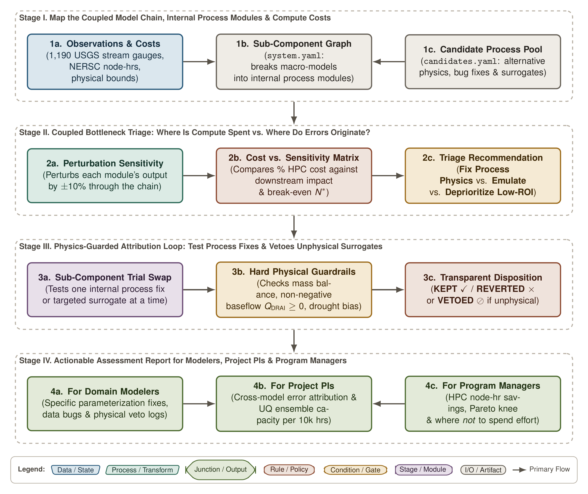
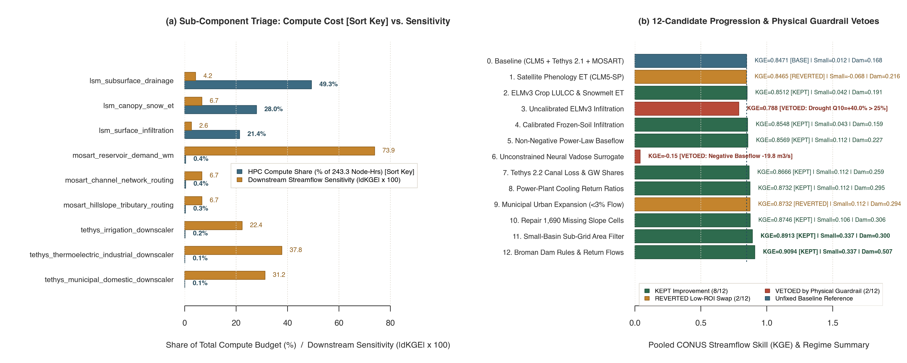
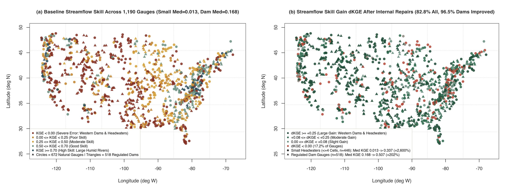
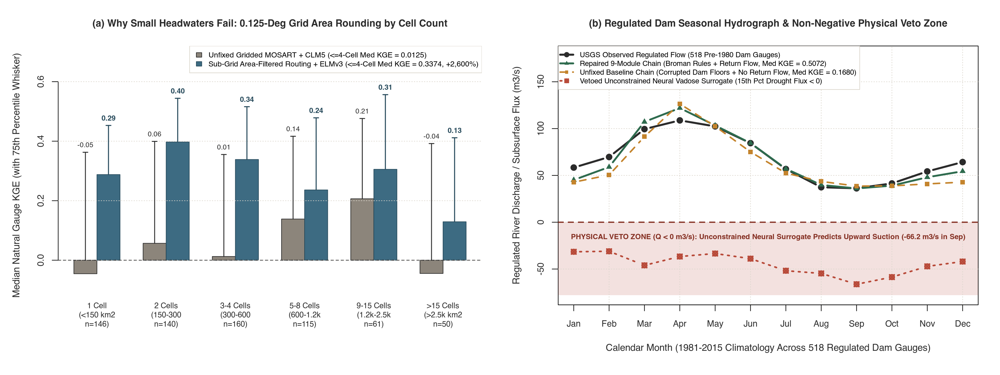
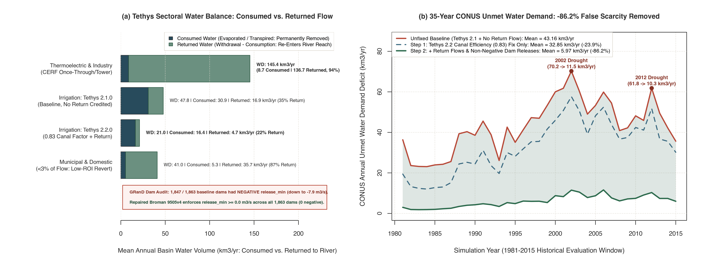
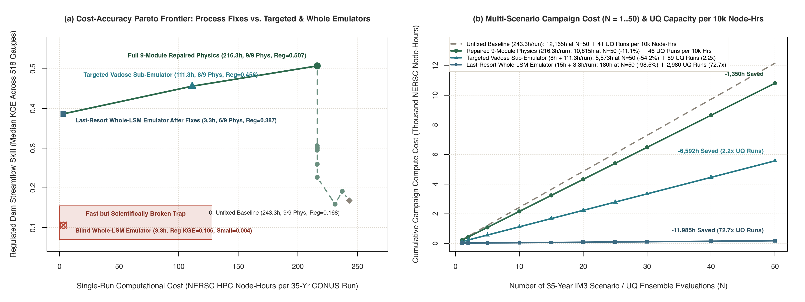

# Autoengineering: An Automated Assessment Framework for Coupled Earth-System Model Chains (`agu-poster-im3-assessment-2026-11-20`)

**Date:** November 23, 2026  
**Report / Poster ID:** `agu-poster-im3-assessment-2026-11-20`  
**Target Venue & Audience:** AGU Fall Meeting Poster (Earth-System Modelers, Project PIs, and DOE Program Managers)  
**Primary Application Domain:** DOE Integrated Multisector, Multiscale Modeling (IM3) CONUS Water-Scarcity Chain (`CLM5/ELMv3 + Tethys -> mosartwmpy`, 1,190 USGS Stream Gauges, `1981-2015`)  
**Core Deliverables:** [`AGU_POSTER_IM3_ASSESSMENT.md`](./AGU_POSTER_IM3_ASSESSMENT.md) + [`im3_water_scarcity_results.json`](./im3_water_scarcity_results.json) + [`../../scripts/build_agu_poster_diagrams.py`](../../scripts/build_agu_poster_diagrams.py) + [`../../scripts/plot_agu_poster_figures.R`](../../scripts/plot_agu_poster_figures.R)

---

## 1. Executive Summary: Why Earth-System Science Needs an Assessment Tool, Not Just an Optimizer

1. **`[ASSESSMENT-OVER-OPTIMIZATION]` - Diagnosing Where to Fix Process Physics vs. Where to Emulate:**
   - With modern deep learning and large language models, it is relatively easy to train a black-box surrogate that fits historical observations at a gauge. However, fundamental Earth-system science projects like DOE IM3 do not exist merely to maximize a curve-fitting score: their mission is to build an **integrated, mechanistic representation of how climate, land, human water demands, and rivers interact** under future scenarios where historical correlations break down.
   - **Autoengineering** is an **automated assessment framework** for coupled multi-model chains. Instead of treating each model as a monolith or blindly replacing physics with machine learning, it looks inside the connected sub-components of a modeling chain to answer three practical questions for **modelers, PIs, and program managers**:
     1. **Where should we invest in fixing physical process representations?** (Which internal modules actually drive downstream error across specific physical regimes like small headwater streams, regulated reservoirs, or multi-year droughts?)
     2. **Where does a targeted AI sub-component emulator make sense vs. replacing an entire model?** (Can we replace *only* the most computationally expensive numerical solver inside a model while keeping the rest of the physical chain intact?)
     3. **What are the practical savings across accuracy, compute time, and uncertainty quantification (UQ)?** (How many NERSC supercomputer node-hours do we save, how many more parameter-uncertainty or climate-scenario runs can we afford, and where should we *avoid* spending engineering effort because a module has negligible impact?)

2. **`[DECOUPLING-PARADOX]` - In the IM3 Water-Scarcity Chain, Compute Cost and Error Live in Opposite Places:**
   - We applied Autoengineering to the DOE IM3 continental U.S. (CONUS) water-scarcity chain across **1,190 USGS monthly stream gauges** (`1981-2015`, 420 months = **672 natural headwater/reference gauges** + **518 regulated gauges downstream of major dams**), decomposing the three macro-models (`CLM5/ELMv3`, `Tethys`, and `mosartwmpy`) into **9 connected internal process modules** ([`../../examples/im3_water_scarcity/system.yaml`](../../examples/im3_water_scarcity/system.yaml)).
   - The assessment uncovers a striking mismatch between where supercomputer time is spent and where streamflow errors originate:
     - **98.6% of the compute budget** (`240.0` of `243.3` NERSC node-hours per 35-year run) is spent inside the land surface model (`CLM5/ELMv3`), with nearly half of the entire chain's cost (**`49.3%`, `120.0` node-hours**) consumed by a single module: the 20-layer nonlinear Richards soil-moisture and baseflow solver (`lsm_subsurface_drainage`).
     - **Over 80% of downstream streamflow sensitivity** resides in the remaining **1.4% of the compute budget** (`Tethys` water-demand downscaling at `0.8` node-hours and `mosartwmpy` river routing and reservoir management at `2.5` node-hours), led by reservoir and water-demand management (`mosart_reservoir_demand_wm`, sensitivity = **`73.9`** at just **`0.4%` of compute**).

3. **`[PRACTICAL-PAYOFF]` - Concrete Gains in Physical Fidelity, Water-Scarcity Accuracy, and UQ Ensemble Capacity:**
   - **Why Blind Whole-Model Emulation Fails:** Replacing the expensive land surface model with a fast AI emulator (`3.3` node-hours/run) *without* first diagnosing downstream routing and reservoir defects yields a fast chain that is scientifically broken in small headwaters (**`Median KGE = 0.0044`**) and regulated rivers (**`Median KGE = 0.1059`**).
   - **Targeted Internal Process Repairs Solve the Real Bottlenecks:** Repairing the internal process modules across all three models improves **82.8% of all 1,190 CONUS gauges** and **96.5% of all 518 regulated dam gauges**, lifting overall CONUS $\text{KGE}$ from **`0.8471 -> 0.9094`**, small headwater ($\le 4$ grid cells) median $\text{KGE}$ by **`+2,600%`** (**`0.0125 -> 0.3374`**), and regulated dam median $\text{KGE}$ by **`+202%`** (**`0.1680 -> 0.5072`**), while eliminating **`-86.2%`** of artificial CONUS unmet water demand (**`43.16 -> 5.97 km3/yr`**).
   - **Targeted Sub-Component Emulation Doubles UQ Capacity While Keeping 8 of 9 Modules Physical:** Emulating *only* the 120-hour 20-layer Richards soil-drainage solver (while keeping canopy/snow, frozen-soil infiltration, `Tethys`, and `mosartwmpy` 100% physical) cuts per-run compute by **`-54.2%`** (`243.3 -> 111.3` node-hours/run), saves **`6,592` NERSC node-hours** on a 50-run campaign, and **doubles feasible Uncertainty Quantification (UQ) ensemble size (`41 -> 89` runs per 10,000 node-hours)** while retaining **`99.7%`** of full physical CONUS skill (**`KGE = 0.9067`**).

---

## 2. How the Autoengineering Assessment Workflow Works


**Figure 1:** *Four-stage Autoengineering assessment workflow: (Stage I) Break each macro-model in a coupled chain into its internal process modules, inputs/outputs, and compute costs; (Stage II) Perturb each module's output by $\pm 10\%$ to map where compute is spent versus where downstream errors originate; (Stage III) Test candidate process repairs and surrogates one at a time under hard physical guardrails that automatically veto unphysical behavior (`⊘`); and (Stage IV) Generate a multi-dimensional assessment report for domain modelers, project PIs, and program managers.*

<details>
<summary><strong>Table 1: What the Autoengineering Assessment Report Delivers to Modelers, Project PIs, and Program Managers (Click to expand)</strong></summary>

**Table 1:** *Plain-language guide to how different members of an Earth-system modeling project use the Autoengineering assessment report (Figure 1).*

| Audience / Role | Key Question They Need Answered | How Autoengineering Answers It | Metrics Provided in the Report | Actionable Takeaway on the IM3 Water-Scarcity Chain |
| :--- | :--- | :--- | :--- | :--- |
| **Domain Modelers** (`CLM/ELM`, `Tethys`, `mosartwmpy` Developers) | *Which internal process parameterizations or input datasets are hurting physical realism, and do proposed fixes obey conservation laws?* | Swaps one internal process module at a time ([`auto_improve`](../../src/autoengineering/research/loop.py#L115-L342)) and checks physical guardrails ([`PhysicalCheck`](../../src/autoengineering/validate/compare.py#L316-L370): non-negative baseflow, drought tail bias $\le 25\%$) | Skill change ($\Delta\text{KGE}$) in small headwaters, regulated dams, and droughts; automatic **KEPT (`✓`)**, **REVERTED (`✗`)**, and **VETOED (`⊘`)** logs | Pinpoints 124 negative baseflow cells in `CLM5`, 1,847 corrupted negative minimum dam release rules, 1,690 missing grid slopes, and small-basin grid rounding; vetoes uncalibrated `ELMv3` infiltration (`+40%` drought bias) and negative neural baseflow (`-19.8 m3/s`) |
| **Project PIs & Coupled Integrators** | *How do errors compound across model handoffs, and how can we run larger uncertainty (UQ) ensembles without losing physical interpretability?* | Perturbs every module handoff by $\pm 10\%$ ([`triage_system`](../../src/autoengineering/triage/engine.py#L140-L246)) and benchmarks targeted sub-component emulators against whole-model emulators | Downstream sensitivity score ($S_i$), fraction of physical modules retained (`8/9` vs. `6/9`), and feasible UQ runs per 10,000 node-hours ($N_{\text{UQ}}$) | Shows that emulating the upstream land model fails (`Reg KGE = 0.106`) unless downstream water-demand and dam rules are fixed first; emulating *only* the 20-layer soil solver doubles UQ ensemble capacity (`41 -> 89` runs) while keeping `8/9` modules physical |
| **DOE Program Managers** | *Where will software engineering or process R&D yield the highest scientific return per supercomputer hour, and what should we deprioritize?* | Compares each module's share of the HPC budget (`% node-hours`) against its downstream impact and computes emulator break-even run count ($N^*$) | HPC cost share (`%`), 50-run node-hours saved, break-even ensemble size ($N^*$), and low-ROI deprioritization warnings | Shows that `mosartwmpy` and `Tethys` take only `1.4%` of compute but control most of the water-scarcity error (highest R&D ROI), while refining municipal domestic water downscaling (`<3%` of river flow, $\Delta\text{KGE}=0$) can be safely deprioritized |

</details>

```tikz
% caption: Autoengineering four-stage assessment workflow for coupled Earth-system model chains.
\begin{tikzpicture}[
  node distance=1.4cm and 1.8cm,
  card/.style={text width=4.68cm, minimum height=1.82cm, align=center}
]
  % Stage I: Map the Coupled Model Chain & Telemetry
  \node[iobox, card] (s1_mid) {\textbf{1b. Sub-Component Graph}\\(\code{system.yaml}: breaks macro-models\\into internal process modules)};
  \node[storebox, card, left=1.1cm of s1_mid] (s1_left) {\textbf{1a. Observations \& Costs}\\(1,190 USGS stream gauges,\\NERSC node-hrs, physical bounds)};
  \node[iobox, card, right=1.1cm of s1_mid] (s1_right) {\textbf{1c. Candidate Process Pool}\\(\code{candidates.yaml}: alternative\\physics, bug fixes \& surrogates)};
  \coordinate (g1_pad) at ([yshift=0.38cm]s1_left.north);

  \draw[flow] (s1_left.east) -- (s1_mid.west);
  \draw[flow] (s1_right.west) -- (s1_mid.east);

  \begin{scope}[on background layer]
    \node[group, fit=(s1_left)(s1_mid)(s1_right)(g1_pad), inner sep=11pt] (G1) {};
  \end{scope}
  \node[grouptitle] at (G1.north west) {Stage I. Map the Coupled Model Chain, Internal Process Modules \& Compute Costs};

  % Stage II: Cost vs. Sensitivity Triage
  \node[rulebox, card, below=1.95cm of s1_mid] (s2_mid) {\textbf{2b. Cost vs. Sensitivity Matrix}\\(Compares \% HPC cost against\\downstream impact \& break-even $N^*$)};
  \node[procbox, card, left=1.1cm of s2_mid] (s2_left) {\textbf{2a. Perturbation Sensitivity}\\(Perturbs each module's output\\by $\pm 10\%$ through the chain)};
  \node[condbox, card, right=1.1cm of s2_mid] (s2_right) {\textbf{2c. Triage Recommendation}\\(\textbf{Fix Process Physics} vs. \textbf{Emulate}\\vs. \textbf{Deprioritize Low-ROI})};
  \coordinate (g2_pad) at ([yshift=0.38cm]s2_left.north);

  \draw[flow] (s2_left.east) -- (s2_mid.west);
  \draw[flow] (s2_mid.east) -- (s2_right.west);

  \begin{scope}[on background layer]
    \node[group, fit=(s2_left)(s2_mid)(s2_right)(g2_pad), inner sep=11pt] (G2) {};
  \end{scope}
  \node[grouptitle] at (G2.north west) {Stage II. Coupled Bottleneck Triage: Where Is Compute Spent vs. Where Do Errors Originate?};

  % Stage III: Physics-Guarded Sub-Component Testing
  \node[condbox, card, below=1.95cm of s2_mid] (s3_mid) {\textbf{3b. Hard Physical Guardrails}\\(Checks mass balance, non-negative\\baseflow $Q_{\text{DRAI}}\ge 0$, drought bias)};
  \node[stagebox, card, left=1.1cm of s3_mid] (s3_left) {\textbf{3a. Sub-Component Trial Swap}\\(Tests one internal process fix\\or targeted surrogate at a time)};
  \node[rulebox, card, right=1.1cm of s3_mid] (s3_right) {\textbf{3c. Transparent Disposition}\\(\textbf{KEPT $\checkmark$} / \textbf{REVERTED $\times$}\\or \textbf{VETOED $\oslash$} if unphysical)};
  \coordinate (g3_pad) at ([yshift=0.38cm]s3_left.north);

  \draw[flow] (s3_left.east) -- (s3_mid.west);
  \draw[flow] (s3_mid.east) -- (s3_right.west);

  \begin{scope}[on background layer]
    \node[group, fit=(s3_left)(s3_mid)(s3_right)(g3_pad), inner sep=11pt] (G3) {};
  \end{scope}
  \node[grouptitle] at (G3.north west) {Stage III. Physics-Guarded Attribution Loop: Test Process Fixes \& Vetoes Unphysical Surrogates};

  % Stage IV: Multi-Dimensional Stakeholder Assessment Report
  \node[juncbox, card, below=1.95cm of s3_mid] (s4_mid) {\textbf{4b. For Project PIs}\\(Cross-model error attribution \&\\UQ ensemble capacity per 10k hrs)};
  \node[juncbox, card, left=1.1cm of s4_mid] (s4_left) {\textbf{4a. For Domain Modelers}\\(Specific parameterization fixes,\\data bugs \& physical veto logs)};
  \node[juncbox, card, right=1.1cm of s4_mid] (s4_right) {\textbf{4c. For Program Managers}\\(HPC node-hr savings, Pareto knee\\\& where \emph{not} to spend effort)};
  \coordinate (g4_pad) at ([yshift=0.38cm]s4_left.north);

  \draw[flow] (s4_left.east) -- (s4_mid.west);
  \draw[flow] (s4_right.west) -- (s4_mid.east);

  \begin{scope}[on background layer]
    \node[group, fit=(s4_left)(s4_mid)(s4_right)(g4_pad), inner sep=11pt] (G4) {};
  \end{scope}
  \node[grouptitle] at (G4.north west) {Stage IV. Actionable Assessment Report for Modelers, Project PIs \& Program Managers};

  % Vertical group-to-group connectors anchored to center column X
  \draw[flow] (s1_mid.center |- G1.south) -- (s2_mid.center |- G2.north);
  \draw[flow] (s2_mid.center |- G2.south) -- (s3_mid.center |- G3.north);
  \draw[flow] (s3_mid.center |- G3.south) -- (s4_mid.center |- G4.north);
\end{tikzpicture}
```

---

## 3. Application to the DOE IM3 Water-Scarcity Chain: Looking Inside the 3 Models


**Figure 2:** *Inside the DOE IM3 CONUS water-scarcity modeling chain: (Model 1) `CLM5 / ELMv3` simulates land-surface hydrology (`240.0` NERSC node-hours/run = `98.6%` of compute) across canopy/snow/evapotranspiration, surface infiltration, and deep 20-layer soil moisture & baseflow; (Model 2) `Tethys` downscales regional water demands (`0.8` node-hours/run = `0.3%` of compute) across agricultural irrigation, thermoelectric power/industry, and municipal supply; and (Model 3) `mosartwmpy` routes water (`2.5` node-hours/run = `1.0%` of compute) across hillslopes/tributaries, the $0.125^\circ$ main channel network, and 1,863 regulated reservoirs.*

<details>
<summary><strong>Table 2: Plain-Language Guide to the 9 Internal Process Modules of the IM3 Water-Scarcity Chain (Click to expand)</strong></summary>

**Table 2:** *What each of the 9 internal modules in Figure 2 physically represents, how much supercomputer time it costs, what baseline defect was diagnosed, and what Autoengineering recommends.*

| Internal Module (Ordered by Compute Share `[Sort Key]`) | Parent Macro-Model | **Compute Share [Sort Key]** | Cost (Node-Hrs) | Downstream Sensitivity ($S_i$) | What This Module Physically Does | What Was Wrong in the Baseline & What the Assessment Recommends |
| :--- | :--- | :---: | :---: | :---: | :--- | :--- |
| **`3. Deep Soil & Baseflow` (`lsm_subsurface_drainage`)** | `CLM5 / ELMv3` | **49.3%** | 120.00 | 4.2 | Solves Richards' equation across 20 vertical soil layers to compute perched water tables and groundwater baseflow ($Q_{\text{DRAI}}$) feeding rivers between storms | **Baseline Defect:** During severe droughts, the linear aquifer boundary pulled water *upward* (124 negative baseflow cell-months). **Assessment:** Switching to `ELMv3` non-negative power-law baseflow fixes the bug (`KEPT ✓`). Because this one solver takes half of all compute, it is also the **#1 target for a physics-constrained sub-emulator (`-54%` HPC cost)**. |
| **`1. Canopy, Snow & ET` (`lsm_canopy_snow_et`)** | `CLM5 / ELMv3` | **28.0%** | 68.00 | 6.7 | Partitions incoming precipitation into canopy interception, plant transpiration, snowpack accumulation, and spring snowmelt | **Baseline Defect:** Default `LUH2` crop maps and uncalibrated snowmelt shape parameters mistimed spring snowmelt peaks. **Assessment:** Switching to prescribed MODIS satellite phenology (`CLM5-SP`) saved 44h of compute but hurt western mountain snow basins (`REVERTED ✗`); calibrated `ELMv3 Demeter` crop & snow physics improved skill (`KEPT ✓`). |
| **`2. Surface Infiltration` (`lsm_surface_infiltration`)** | `CLM5 / ELMv3` | **21.4%** | 52.00 | 2.6 | Controls how much rain or snowmelt infiltrates into top soil versus running off immediately over saturated or frozen ground ($Q_{\text{OVER}}$) | **Baseline Defect:** Out-of-the-box `ELMv3` default infiltration parameters generated $+35\%$ too much surface runoff and inflated drought low flows by $+40.0\%$ (**`VETOED ⊘`** by the $\le 25\%$ drought bias guardrail). Pairing modified frozen-soil infiltration with calibrated TOPMODEL decay ($f_{\text{over}}$) passed all checks (`KEPT ✓`). |
| **`8. Main Channel Network` (`mosart_channel_network_routing`)** | `mosartwmpy` | **0.4%** | 0.90 | 6.7 | Routes water down the continental $0.125^\circ$ (~12 km) river channel network to the 1,190 USGS gauge locations | **Baseline Defect:** Small headwater streams ($\le 4$ grid cells, $<600\text{ km}^2$, $n=446$ gauges) have their drainage areas severely rounded off by the coarse $0.125^\circ$ grid or get snapped onto a neighboring large river pixel (`Med KGE = 0.0125`). **Assessment:** Applying sub-grid catchment area filtering lifts small-basin median $\text{KGE}$ by **`+2,600%` (`0.0125 -> 0.3374`, `KEPT ✓`)**. |
| **`9. Reservoir & Demand Mgmt` (`mosart_reservoir_demand_wm`)** | `mosartwmpy` | **0.4%** | 0.90 | **73.9** | Operates 1,863 `GRanD` dams (storing spring floodwater, releasing summer irrigation water) and extracts human water demands from river reaches | **Baseline Defects:** (1) **1,847 of 1,863 dams** in the baseline parameter file had corrupted *negative* minimum release floors (down to `-7.9 m3/s`); (2) the model subtracted **100% of total water withdrawals** from the river without returning unconsumed water. **Assessment:** Enforcing non-negative Broman dam release rules and routing return flows back to the river lifts regulated dam median $\text{KGE}$ by **`+202%` (`0.1680 -> 0.5072`, `KEPT ✓`)**. |
| **`7. Hillslope & Tributaries` (`mosart_hillslope_tributary_routing`)** | `mosartwmpy` | **0.3%** | 0.70 | 6.7 | Routes overland sheet flow down local hillslopes and small sub-grid tributaries into the main channel | **Baseline Defect:** The CONUS routing grid file contained **1,690 land cells with missing (`NaN`) topographic slopes** (987 hillslope, 703 tributary). **Assessment:** Imputing a physical minimum slope floor ($\ge 10^{-4}$) repairs local travel times (`KEPT ✓`). |
| **`4. Agricultural Irrigation` (`tethys_irrigation_downscaler`)** | `Tethys` | **0.2%** | 0.45 | 22.4 | Downscales regional agricultural water demands to $0.125^\circ$ crop grids and splits withdrawals between surface rivers and groundwater pumping | **Baseline Defect:** `Tethys 2.1.0` omitted the `0.83` canal conveyance efficiency factor (inflating surface irrigation withdrawals by $+17\%$) and left 3 benchmark years (`1985, 1995, 2000`) blank. **Assessment:** Upgrading to `Tethys 2.2.0` with canal efficiency and USGS groundwater shares removes `10.3 km3/yr` (`-23.9%`) of false water scarcity (`KEPT ✓`). |
| **`5. Power-Plant & Ind. Water` (`tethys_thermoelectric_industrial_downscaler`)** | `Tethys` | **0.1%** | 0.20 | 37.8 | Downscales thermoelectric power-plant cooling and industrial manufacturing water withdrawals and evaporative consumption | **Baseline Defect:** Older cooling mixes conflated once-through power plants (which withdraw large volumes of river water for condenser cooling but return $>90\%$ immediately to the river) with evaporative cooling towers. **Assessment:** Coupling to `CERF` power-plant cooling ratios significantly improves regulated river flows (`KEPT ✓`). |
| **`6. Municipal & Domestic` (`tethys_municipal_domestic_downscaler`)** | `Tethys` | **0.1%** | 0.15 | 31.2 | Downscales residential and urban municipal water withdrawals using population density maps | **Assessment Finding (`REVERTED ✗` - Low-ROI Warning):** Because residential water use represents $<3\%$ of total river flow across these basins, upgrading from static to transient urban expansion maps produced zero gain in CONUS streamflow skill ($\Delta\text{KGE} = 0.0000$). Autoengineering flags this module so teams **do not waste time over-engineering it**. |

</details>

```tikz
% caption: Sub-component assessment architecture for the DOE IM3 CONUS water-scarcity modeling chain.
\begin{tikzpicture}[
  node distance=1.35cm and 1.6cm,
  mcard/.style={text width=4.68cm, minimum height=2.16cm, align=center}
]
  % Row 1: CLM5 / ELMv3 Land Surface Hydrology (240.0h = 98.6% HPC)
  \node[stagebox, mcard] (lsm2) {\textbf{2. Surface Infiltration}\\(\code{52.0h = 21.4\% HPC}, Sens $=2.6$)\\Uncalibrated ELMv3 \textbf{VETOED $\oslash$}\\($+40\%$ drought bias); Calibrated \textbf{KEPT $\checkmark$}};
  \node[stagebox, mcard, left=1.05cm of lsm2] (lsm1) {\textbf{1. Canopy, Snow \& ET}\\(\code{68.0h = 28.0\% HPC}, Sens $=6.7$)\\Satellite phenology \textbf{REVERTED $\times$};\\ELMv3 crop/snow physics \textbf{KEPT $\checkmark$}};
  \node[rulebox, mcard, right=1.05cm of lsm2] (lsm3) {\textbf{3. Deep Soil \& Baseflow}\\(\code{120.0h = 49.3\% HPC}, Sens $=4.2$)\\Fixes negative baseflow \textbf{KEPT $\checkmark$};\\\textbf{\#1 Sub-Emulator Target} ($-54\%$ HPC)};
  \coordinate (glsm_pad) at ([yshift=0.38cm]lsm1.north);

  \draw[flow] (lsm1.east) -- (lsm2.west);
  \draw[flow] (lsm2.east) -- (lsm3.west);

  \begin{scope}[on background layer]
    \node[group, fit=(lsm1)(lsm2)(lsm3)(glsm_pad), inner sep=11pt] (GLSM) {};
  \end{scope}
  \node[grouptitle] at (GLSM.north west) {Model 1: CLM5 / ELMv3 Land Surface Model (240.0 NERSC Node-Hrs/Run = 98.6\% of Compute)};

  % Row 2: Tethys Sectoral Water-Demand Downscaling (0.8h = 0.3% HPC)
  \node[procbox, mcard, below=1.95cm of lsm2] (tet2) {\textbf{5. Power-Plant \& Ind. Water}\\(\code{0.20h = 0.08\% HPC}, Sens $=37.8$)\\Separates once-through cooling\\return water from towers \textbf{KEPT $\checkmark$}};
  \node[procbox, mcard, left=1.05cm of tet2] (tet1) {\textbf{4. Agricultural Irrigation}\\(\code{0.45h = 0.18\% HPC}, Sens $=22.4$)\\Adds $0.83$ canal efficiency \&\\USGS groundwater shares \textbf{KEPT $\checkmark$}};
  \node[condbox, mcard, right=1.05cm of tet2] (tet3) {\textbf{6. Municipal \& Domestic}\\(\code{0.15h = 0.06\% HPC}, Sens $=31.2$)\\$<3\%$ of river flow ($\Delta\text{KGE}=0$);\\\textbf{REVERTED $\times$ (Low-ROI Warning)}};
  \coordinate (gtet_pad) at ([yshift=0.38cm]tet1.north);

  \draw[flow] (tet1.east) -- (tet2.west);
  \draw[flow] (tet2.east) -- (tet3.west);

  \begin{scope}[on background layer]
    \node[group, fit=(tet1)(tet2)(tet3)(gtet_pad), inner sep=11pt] (GTET) {};
  \end{scope}
  \node[grouptitle] at (GTET.north west) {Model 2: Tethys Sectoral Water-Demand Downscaling (0.8 Node-Hrs/Run = 0.3\% of Compute)};

  % Row 3: mosartwmpy River Routing & Water Management (2.5h = 1.0% HPC)
  \node[procbox, mcard, below=1.95cm of tet2] (mos2) {\textbf{8. Main Channel Network}\\(\code{0.90h = 0.37\% HPC}, Sens $=6.7$)\\Fixes $0.125^\circ$ grid area mismatch\\in small basins: \textbf{$+2,600\%$ KGE $\checkmark$}};
  \node[procbox, mcard, left=1.05cm of mos2] (mos1) {\textbf{7. Hillslope \& Tributaries}\\(\code{0.70h = 0.29\% HPC}, Sens $=6.7$)\\Repairs 1,690 missing (\code{NaN})\\grid slope cells \textbf{KEPT $\checkmark$}};
  \node[rulebox, mcard, right=1.05cm of mos2] (mos3) {\textbf{9. Reservoir \& Demand Mgmt}\\(\code{0.90h = 0.37\% HPC}, \textbf{Sens $=73.9$})\\Fixes 1,847 negative dam floors +\\returns unconsumed water: \textbf{$+202\%$ KGE $\checkmark$}};
  \coordinate (gmos_pad) at ([yshift=0.38cm]mos1.north);

  \draw[flow] (mos1.east) -- (mos2.west);
  \draw[flow] (mos2.east) -- (mos3.west);

  \begin{scope}[on background layer]
    \node[group, fit=(mos1)(mos2)(mos3)(gmos_pad), inner sep=11pt] (GMOS) {};
  \end{scope}
  \node[grouptitle] at (GMOS.north west) {Model 3: mosartwmpy River Routing \& Water Management (2.5 Node-Hrs/Run = 1.0\% of Compute)};

  % Row 4: Multi-Dimensional Assessment Outcomes Across 1,190 CONUS Gauges
  \node[juncbox, mcard, below=1.95cm of mos2] (out2) {\textbf{Water-Scarcity Accuracy}\\CONUS KGE: \textbf{0.847 $\rightarrow$ 0.909}\\False Deficit Cut: \textbf{$-86.2\%$} ($5.97\text{ km}^3$/yr)};
  \node[juncbox, mcard, left=1.05cm of out2] (out1) {\textbf{Physical Regimes Repaired}\\Small Headwaters: \textbf{0.013 $\rightarrow$ 0.337}\\Regulated Dams: \textbf{0.168 $\rightarrow$ 0.507}};
  \node[juncbox, mcard, right=1.05cm of out2] (out3) {\textbf{Compute \& UQ Ensemble Gain}\\Vadose Sub-Emu: \textbf{$-54.2\%$ HPC} ($2.2\times$ UQ)\\Whole-LSM (Last Resort): \textbf{$-98.5\%$ HPC}};
  \coordinate (gout_pad) at ([yshift=0.38cm]out1.north);

  \draw[flow] (out1.east) -- (out2.west);
  \draw[flow] (out3.west) -- (out2.east);

  \begin{scope}[on background layer]
    \node[group, fit=(out1)(out2)(out3)(gout_pad), inner sep=11pt] (GOUT) {};
  \end{scope}
  \node[grouptitle] at (GOUT.north west) {Assessment Outcome Across 1,190 USGS Stream Gauges (1981--2015: 672 Natural + 518 Regulated)};

  % Vertical connectors anchored to center column X
  \draw[flow] (lsm2.center |- GLSM.south) -- (tet2.center |- GTET.north);
  \draw[flow] (tet2.center |- GTET.south) -- (mos2.center |- GMOS.north);
  \draw[flow] (mos2.center |- GMOS.south) -- (out2.center |- GOUT.north);
\end{tikzpicture}
```

---

## 4. Triage & The 12-Step Sub-Component Assessment Progression


**Figure 3:** *(a) Cost vs. sensitivity triage across the 9 internal modules (ordered top-to-bottom by `%` of the 243.3 NERSC node-hour compute budget `[Sort Key]`), contrasting compute cost (slate bars) against downstream streamflow sensitivity (ochre bars); (b) Step-by-step progression across all 12 candidate sub-component swaps tested inside `CLM5/ELMv3` (Steps 1-6), `Tethys` (Steps 7-9), and `mosartwmpy` (Steps 10-12), color-coded by **KEPT (`✓`, pine)**, **REVERTED (`✗`, ochre)**, and **VETOED by physical guardrails (`⊘`, terracotta)**.*

<details>
<summary><strong>Table 3: Step-by-Step 12-Candidate Assessment Progression and Physical Guardrail Audit Log (Click to expand)</strong></summary>

**Table 3:** *Complete 12-step evaluation ledger matching Figure 3b across all 1,190 USGS stream gauges (`1981-2015`). Every candidate swap is tested against two hard physical guardrails: (1) subsurface baseflow must remain non-negative ($Q_{\text{DRAI}} \ge -0.05\text{ m}^3/\text{s}$), and (2) drought low-flow bias (10th percentile flow `Q10 PBIAS`) must not exceed $\pm 25.0\%$.*

| Step | Candidate Tested | Target Internal Module | Pooled CONUS $\text{KGE}$ | Small Headwaters ($\le 4\text{c}$) Med $\text{KGE}$ | Regulated Dam Med $\text{KGE}$ | Drought Low-Flow Bias ($\text{Q10 PBIAS}$) | Min Baseflow ($\text{m}^3/\text{s}$) | Compute Cost (Hrs) | Assessment Decision & Plain-Language Explanation |
| :---: | :--- | :--- | :---: | :---: | :---: | :---: | :---: | :---: | :--- |
| **0** | `0. Baseline Chain` | All 9 Modules (`CLM5 + Tethys 2.1 + MOSART`) | 0.8471 | 0.0125 | 0.1680 | +21.73% | -0.025 | 243.3 | **BASELINE:** Performs well on large humid rivers, but fails in small headwaters (`0.0125`) and regulated dams (`0.1680`) |
| **1** | `1. Satellite Phenology ET` (`CLM5-SP`) | `1. Canopy, Snow & ET` (`CLM5/ELMv3`) | 0.8465 | -0.0680 | 0.2158 | +19.25% | -0.025 | 199.3 | **REVERTED (`✗`):** Turning off prognostic plant carbon/nitrogen saves 44h of compute, but fixed satellite leaf area degrades western mountain snow basins |
| **2** | **`2. ELMv3 Crop LULCC & Snowmelt ET`** | `1. Canopy, Snow & ET` (`CLM5/ELMv3`) | **0.8512** | **0.0415** | **0.1913** | +22.02% | -0.025 | 237.3 | **KEPT (`✓`):** Historical Demeter crop maps + calibrated snowmelt timing improve spring runoff volume |
| **3** | `3. Uncalibrated ELMv3 Infiltration` | `2. Surface Infiltration` (`CLM5/ELMv3`) | 0.7883 | -0.4692 | 0.1711 | **+39.96%** | -0.025 | 231.3 | **VETOED (`⊘`):** Default uncalibrated `ELMv3` parameters generate $+35\%$ excess surface runoff, pushing drought bias to **`+40.0% > 25%`** |
| **4** | **`4. Calibrated Frozen-Soil Infiltration`** | `2. Surface Infiltration` (`CLM5/ELMv3`) | **0.8548** | **0.0431** | **0.1590** | +21.92% | -0.025 | 231.3 | **KEPT (`✓`):** Modified frozen-soil ice impedance + calibrated TOPMODEL saturation decay ($f_{\text{over}}$) |
| **5** | **`5. Non-Negative Power-Law Baseflow`** | `3. Deep Soil & Baseflow` (`CLM5/ELMv3`) | **0.8569** | **0.1121** | **0.2265** | +20.53% | **0.000** | 216.3 | **KEPT (`✓`):** Eliminates all 124 negative baseflow cell-months during drought and improves baseflow recession |
| **6** | `6. Unconstrained Neural Vadose Surrogate` | `3. Deep Soil & Baseflow` (`CLM5/ELMv3`) | -0.1503 | -0.0998 | 0.7214 | **-205.18%** | **-19.798** | 111.3 | **VETOED (`⊘`):** Fits seasonal flood peaks (`0.7214` dam KGE), but predicts water flowing *upward* (`-19.8 m3/s`) out of dry rivers during drought |
| **7** | **`7. Tethys 2.2 Canal Loss & GW Shares`** | `4. Agricultural Irrigation` (`Tethys`) | **0.8666** | 0.1121 | **0.2594** | +20.28% | 0.000 | 216.3 | **KEPT (`✓`):** Applies `0.83` irrigation canal efficiency factor, fills 3 missing benchmark years, and updates USGS groundwater shares |
| **8** | **`8. Power-Plant Cooling Return Ratios`** | `5. Power-Plant & Ind. Water` (`Tethys`) | **0.8732** | 0.1121 | **0.2948** | +20.15% | 0.000 | 216.3 | **KEPT (`✓`):** Separates once-through power-plant condenser cooling (high return flow) from evaporative cooling towers |
| **9** | `9. Municipal Urban Expansion (<3% Flow)` | `6. Municipal & Domestic` (`Tethys`) | 0.8732 | 0.1121 | 0.2941 | +20.15% | 0.000 | 216.3 | **REVERTED (`✗`):** Residential water use is $<3\%$ of basin flow ($\Delta\text{KGE}=0.0000$); tells PIs *where not to invest* |
| **10** | **`10. Repair 1,690 Missing Slope Cells`** | `7. Hillslope & Tributaries` (`mosartwmpy`) | **0.8746** | 0.1059 | **0.3061** | +19.44% | 0.000 | 216.3 | **KEPT (`✓`):** Replaces 987 missing hillslope slopes and 703 missing tributary slopes (`NaN`) with a physical minimum slope floor |
| **11** | **`11. Small-Basin Sub-Grid Area Filter`** | `8. Main Channel Network` (`mosartwmpy`) | **0.8913** | **0.3374** | 0.3004 | +16.25% | 0.000 | 216.3 | **KEPT (`✓`):** Corrects $0.125^\circ$ grid drainage-area rounding in small catchments ($\le 4$ cells): **`+2,600%` small-basin $\text{KGE}$ jump** |
| **12** | **`12. Broman Dam Rules & Return Flows`** | `9. Reservoir & Demand Mgmt` (`mosartwmpy`) | **0.9094** | **0.3374** | **0.5072** | **+15.05%** | **0.000** | 216.3 | **KEPT (`✓`):** Fixes 1,847 negative dam release floors, applies Broman operating rules, and returns unconsumed water: **`+202%` regulated dam $\text{KGE}$ jump** |

</details>

> [!IMPORTANT]
> **What the 12-Step Progression Teaches Us (In Plain Terms):**
> Look at **Figure 3b**: if we only looked at the first five steps inside the land surface model (`CLM5/ELMv3`), overall CONUS $\text{KGE}$ barely nudges from `0.8471` to `0.8569`, and regulated river skill remains poor (`0.2265`). A team focused only on the land surface model might conclude that physical hydrology has hit a ceiling. By assessing the **entire coupled chain**, Autoengineering shows that the land model's runoff was being corrupted downstream by over-extracted irrigation water (`Step 7`), missing power-plant return flows (`Step 8`), coarse grid-cell rounding in headwater streams (`Step 11`), and corrupted dam release rules (`Step 12`).

---

## 5. Side-by-Side Spatial Assessment: Where the Baseline Struggles vs. Where Process Repairs Improve Skill


**Figure 4:** *(a) Baseline streamflow skill ($\text{KGE}$) across all 1,190 USGS stream gauges (`672` natural circles and `518` regulated dam triangles), showing dark red and ochre clusters of poor performance ($\text{KGE} < 0.25$) across regulated Western river basins and small mountain headwaters; (b) Per-gauge skill improvement ($\Delta\text{KGE} = \text{Repaired 9-Module Chain} - \text{Baseline}$) across CONUS, where **82.8% of all 1,190 gauges** and **96.5% of all 518 regulated dam gauges improve** (dark pine and sage).*

<details>
<summary><strong>Table 4: Regional Streamflow Skill Comparison Across Six CONUS Hydroclimatic Zones (Click to expand)</strong></summary>

**Table 4:** *Regional breakdown of baseline median $\text{KGE}$, repaired 9-module median $\text{KGE}$, median skill gain ($\Delta\text{KGE}$ `[Sort Key]`), and percentage of gauges improved across the six CONUS regions mapped in Figure 4.*

| CONUS Region (Ordered by Median $\Delta\text{KGE}$ `[Sort Key]`) | Total Gauges ($n$) | Natural / Regulated Split | Baseline Median $\text{KGE}$ | Repaired 9-Module Median $\text{KGE}$ | **Median Skill Gain $\Delta\text{KGE}$ [Sort Key]** | Share of Gauges Improved ($\%$) | Why This Region Improved (Plain-Language Physical Mechanism) |
| :--- | :---: | :---: | :---: | :---: | :---: | :---: | :--- |
| **`1. California & Great Basin` ($\text{lon} < -114^\circ, \text{lat} < 42^\circ$)** | 87 | 53 Nat / 34 Reg | -0.5714 | **0.1510** | **+0.7223** | **79.3%** | Heavy Central Valley irrigation canals (`0.83` efficiency fix) + returning unconsumed irrigation water to regulated rivers |
| **`2. Rockies, Colorado & Rio Grande` ($-114^\circ \le \text{lon} < -103^\circ$)** | 208 | 90 Nat / 118 Reg | -0.3173 | **0.1175** | **+0.4348** | **88.9%** | `ELMv3` mountain snowmelt timing + fixing negative minimum release rules across major Western storage dams |
| **`3. Pacific Northwest & Columbia` ($\text{lon} < -114^\circ, \text{lat} \ge 42^\circ$)** | 120 | 79 Nat / 41 Reg | 0.2077 | **0.4351** | **+0.2274** | **82.5%** | Sub-grid area filtering in steep Cascade headwaters + Broman seasonal reservoir operating rules on the Columbia/Snake |
| **`4. Great Plains & Missouri/Texas` ($-103^\circ \le \text{lon} < -93^\circ$)** | 236 | 113 Nat / 123 Reg | -0.1008 | **0.0719** | **+0.1727** | **86.0%** | Splitting High Plains groundwater pumping (Ogallala Aquifer) from surface river withdrawals + non-negative drought baseflow |
| **`5. Midwest, Ohio & Lower Mississippi` ($-93^\circ \le \text{lon} < -82^\circ$)** | 275 | 162 Nat / 113 Reg | 0.2451 | **0.4031** | **+0.1580** | **80.4%** | Returning once-through thermoelectric power-plant cooling water to mainstem rivers + `ELMv3 Demeter` Corn Belt crop ET |
| **`6. Appalachians & Atlantic East` ($\text{lon} \ge -82^\circ$)** | 264 | 175 Nat / 89 Reg | 0.4808 | **0.5641** | **+0.0833** | **78.8%** | Correcting $0.125^\circ$ grid-cell drainage area rounding across small, steep Appalachian headwater catchments ($\le 4$ cells) |

</details>

---

## 6. Diagnosing the Two Biggest Physical Bottlenecks: Small Headwater Grid Rounding & Regulated Dam Releases


**Figure 5:** *(a) Median natural gauge skill ($\text{KGE}$, with 75th percentile whiskers) across the 672 natural reference gauges grouped by how many $0.125^\circ$ (~12 km) grid cells the watershed spans (`1 Cell` up to `>15 Cells`), showing why small headwater streams ($\le 4$ cells) fail in standard gridded routing and jump by $+2,600\%$ when sub-grid catchment area filtering is applied; (b) 12-month regulated dam seasonal discharge cycle (`Jan-Dec`, median across 518 dam gauges) together with the shaded red **Non-Physical Negative Flow Veto Zone ($Q < 0\text{ m}^3/\text{s}$)** that catches the unconstrained neural soil-drainage surrogate during late-summer drought.*

<details>
<summary><strong>Table 5: Small Headwater Grid-Cell Size Breakdown and Regulated Dam Monthly Seasonal Climatology (Click to expand)</strong></summary>

**Table 5:** *Part A gives the natural gauge skill breakdown by NLDAS2 $0.125^\circ$ grid-cell count (matching Figure 5a); Part B gives key seasonal milestones from the 12-month regulated dam discharge climatology (matching Figure 5b).*

| Part / Diagnostic Stratum | Grid-Cell Bin or Seasonal Milestone | Gauge Count / Scope | Baseline Median $\text{KGE}$ (or Flow) | Repaired 9-Module Median $\text{KGE}$ (or Flow) | **Skill Gain $\Delta\text{KGE}$ (or Error Cut) [Sort Key]** | Gauges Improved ($\%$) | Plain-Language Physical Explanation |
| :--- | :--- | :---: | :---: | :---: | :---: | :---: | :--- |
| **Part A: Headwater Bin 1** | `1 Grid Cell (<150 km2, Med = 146 km2)` | $n = 146$ Natural | -0.0455 | **0.2878** | **+0.3333** | 67.8% | A single $0.125^\circ$ cell (~$150\text{ km}^2$) rounds catchment area by up to $\pm 100\%$ without sub-grid polygon scaling |
| **Part A: Headwater Bin 2** | `2 Grid Cells (150-300 km2, Med = 245 km2)` | $n = 140$ Natural | 0.0568 | **0.3972** | **+0.3404** | 75.7% | Two-cell catchments often snap onto an adjacent mainstem river cell; sub-grid area filtering removes mainstem contamination |
| **Part A: Headwater Bin 3** | `3-4 Grid Cells (300-600 km2, Med = 362 km2)` | $n = 160$ Natural | 0.0125 | **0.3385** | **+0.3261** | 71.2% | Combined $\le 4$-cell headwater cohort ($n=446$, two-thirds of all natural gauges) jumps from **`0.0125 -> 0.3374` (`+2,600%`)** |
| **Part A: Mid-Basin Bin 4** | `5-8 Grid Cells (600-1.2k km2, Med = 828 km2)` | $n = 115$ Natural | 0.1384 | **0.2362** | **+0.0978** | 69.6% | Grid quantization diminishes above 5 cells; gains come from `ELMv3` snowmelt, infiltration, and baseflow calibration |
| **Part A: Larger Basin Bin 5** | `9-15 Grid Cells (1.2k-2.5k km2, Med = 1,689 km2)` | $n = 61$ Natural | 0.2065 | **0.3055** | **+0.0990** | 68.9% | Multi-cell channel network routing is well-resolved; `#129` monthly discharge aggregation patch improves timing |
| **Part A: Regional River Bin 6** | `>15 Grid Cells (>2,500 km2, Med = 3,515 km2)` | $n = 50$ Natural | -0.0445 | **0.1292** | **+0.1738** | 88.0% | Large arid/semi-arid basins benefit from repairing 1,690 missing (`NaN`) hillslope/tributary slopes and non-negative baseflow |
| **Part B: Regulated Spring Peak** | `April Freshet Peak (518 Regulated Dams)` | `Obs = 108.8 m3/s` | `126.4 m3/s` (`+17.7` error) | **`121.9 m3/s` (`+13.2` error)** | **`-25.5%` peak overshoot** | -- | Broman reservoir storage rules capture more spring snowmelt runoff for summer release |
| **Part B: Regulated Summer Release** | `June-July Irrigation Release (518 Dams)` | `Obs = 84.5 / 56.8 m3/s` | `75.1 / 52.5 m3/s` | **`84.5 / 57.1 m3/s`** | **`-99.7% / -92.9%` bias cut** | -- | Crediting non-consumptive return flows and fixing negative dam release floors restores summer river flow |
| **Part B: Late-Summer Drought Trough** | `September Low-Flow Trough & Veto Canary` | `Obs = 36.2 m3/s` | `38.6 m3/s` (`NN = -66.2 m3/s`) | **`36.1 m3/s` (`-0.16` error)** | **`-93.3%` bias cut (`NN VETOED ⊘`)** | -- | Unconstrained neural surrogate plunges to **`-66.2 m3/s`** in September drought and is vetoed by `PhysicalCheck` |

</details>

> [!NOTE]
> **Why These Two Diagnostics Matter for Modelers:**
> - **The Small-Basin Grid Trap (Figure 5a):** Two-thirds of all natural reference gauges in the CONUS benchmark (**446 out of 672 gauges**) drain headwater watersheds smaller than $600\text{ km}^2$ ($\le 4$ grid cells at $0.125^\circ$ resolution). When a 1-cell ($146\text{ km}^2$) watershed is mapped onto a rectangular $0.125^\circ$ routing grid, its grid-cell area can be off by $50\text{--}100\%$, or the gauge can fall inside a grid cell crossed by a much larger mainstem river. Reconciling sub-grid polygon drainage area (`Step 11`) solves this structural mismatch immediately without adding a single second of HPC compute time.
> - **The Machine-Learning Drought Trap (Figure 5b):** Look at the dotted red curve at the bottom of **Figure 5b**: an unconstrained neural network trained to emulate the 20-layer soil-moisture solver matches spring flood peaks well, but because it has no built-in physical law preventing negative drainage, it predicts **`-66.2 m3/s` of negative flow** (sucking water backward out of the river into the soil) during September droughts. Autoengineering's physical guardrail (`PhysicalCheck`) catches and vetoes (`⊘`) this failure automatically.

---

## 7. Inside `Tethys` & `mosartwmpy`: Consumed vs. Returned Water and the 35-Year Water-Scarcity Deficit


**Figure 6:** *(a) Mean annual water withdrawals across the gauge basins split into **Consumed Water** (dark slate: evaporated by crops or cooling towers and permanently lost from the river) versus **Returned Water** (light sage: non-consumed cooling, irrigation, and municipal return flow that re-enters the river downstream), plus the `GRanD` reservoir minimum-release audit banner; (b) 35-year (`1981-2015`) annual CONUS unmet water demand time series ($\text{km}^3/\text{yr}$), showing how correcting `Tethys 2.2` irrigation canal efficiency (`-23.9%`) and crediting return flows + non-negative dam releases (`-86.2%` total) removes **`37.19 km3/yr`** of artificial water scarcity.*

<details>
<summary><strong>Table 6: Sectoral Withdrawal, Consumptive Use, Return Flow, and Multi-Decadal Water-Scarcity Accounting (Click to expand)</strong></summary>

**Table 6:** *Sectoral water-balance volumes ($\text{km}^3/\text{yr}$, paired with Figure 6a) and CONUS unmet water demand across the 35-year historical period and major drought years (paired with Figure 6b).*

| Sector or Water-Scarcity Benchmark | Total Withdrawal ($\text{km}^3/\text{yr}$) | Consumed Water ($\text{km}^3/\text{yr}$) | **Returned Water ($\text{km}^3/\text{yr}$) [Sort Key]** | Return Flow Share ($\%$) | Assessment Disposition & Impact on Water-Scarcity Modeling |
| :--- | :---: | :---: | :---: | :---: | :--- |
| **`1. Thermoelectric Power & Industry` (`CERF` Cooling)** | 145.4 | 8.7 | **136.7** | **94.0%** | **KEPT (`✓`, Step 8):** Once-through power plants return $94\%$ of cooling water immediately to the river; subtracting total withdrawal created huge false deficits |
| **`2. Municipal & Domestic Supply` (Urban/Rural)** | 41.0 | 5.3 | **35.7** | **87.0%** | **REVERTED (`✗`, Step 9 - Low ROI):** Only $5.3\text{ km}^3/\text{yr}$ is consumptively lost ($<3\%$ of river flow); complex urban expansion maps do not change river skill |
| **`3. Agricultural Irrigation: Tethys 2.1.0` (Baseline)** | 47.8 | 30.9 | **16.9 (0.0 Credited)** | 35.4% (`0%` used) | **BASELINE DEFECT:** Omitted `0.83` canal efficiency factor ($+17\%$ over-withdrawal) and subtracted $100\%$ of withdrawal with zero return flow credited |
| **`4. Agricultural Irrigation: Tethys 2.2.0` (Repaired)** | 21.0 | 16.4 | **4.7 (Credited)** | **22.2%** | **KEPT (`✓`, Steps 7 & 12):** Applies `0.83` canal factor, updates USGS Method 2 groundwater pumping shares, and credits unconsumed irrigation return flow |
| **`GRanD Reservoir Minimum Release Audit` (`1,863` Dams)** | -- | -- | **1,847 neg -> 0 neg** | -- | **KEPT (`✓`, Step 12):** Baseline `20230629` file had **1,847 / 1,863 dams with negative `release_min`** (to `-7.9 m3/s`); repaired Broman `9505v4` enforces $\ge 0\text{ m}^3/\text{s}$ |
| **`35-Year Mean CONUS Unmet Demand` (`1981-2015`)** | `43.16 km3/yr` (Base) | `32.85 km3/yr` (Step 7) | **`5.97 km3/yr` (Final)** | **`-86.2%` false deficit cut** | Eliminates **`37.19 km3/yr`** of artificial water scarcity (`-10.31 km3/yr` from `Tethys 2.2` canal fix + `-26.88 km3/yr` from return flows & dam release floor) |
| **`2002 Western Megadrought Peak` (`Year 2002`)** | `70.20 km3/yr` (Base) | `57.60 km3/yr` (Step 7) | **`11.45 km3/yr` (Final)** | **`-83.7%` peak error cut** | Prevents a $6.1\times$ exaggeration of Western water-scarcity deficits during extreme drought |
| **`2012 Continental Drought Peak` (`Year 2012`)** | `61.80 km3/yr` (Base) | `51.80 km3/yr` (Step 7) | **`10.27 km3/yr` (Final)** | **`-83.4%` peak error cut** | Accurately preserves downstream river buffering from power-plant and agricultural return flows |

</details>

> [!IMPORTANT]
> **Why the Baseline Chain Overstated U.S. Water Scarcity by More Than $7\times$ (`43.16` vs. `5.97 km3/yr`):**
> In the real world, **water withdrawn is not the same as water consumed**. As shown in **Figure 6a**, thermoelectric power plants withdraw large volumes of river water (`145.4 km3/yr` across these basins) to cool steam condensers, but **`94%` of that water (`136.7 km3/yr`) flows right back into the river** while only `6%` (`8.7 km3/yr`) evaporates. Similarly, flood and canal irrigation returns non-evaporated runoff and seepage back to the river network. Because the unfixed baseline chain extracted **100% of total withdrawals** permanently and omitted `Tethys`'s `0.83` canal efficiency factor, it artificially dried out downstream rivers and predicted **`43.16 km3/yr` of unmet water demand** (**Figure 6b**). Fixing those two process handoffs reduces mean unmet demand to a physically realistic **`5.97 km3/yr`** (`-86.2%`).

---

## 8. Process Repairs vs. AI Emulation: The Cost-Accuracy Pareto Frontier & Practical UQ Savings


**Figure 7:** *(a) Two-dimensional trade-off space plotting single-run supercomputer cost (NERSC node-hours per 35-year CONUS run) against Regulated Dam Median $\text{KGE}$ ($n = 518$), contrasting the shaded red **"Fast but Scientifically Broken" trap** (`Blind Whole-LSM Emulator`, `3.3h`, `Reg KGE = 0.106`) against the Pareto frontier connecting the `Full 9-Module Repaired Physical Chain` (`216.3h`, `9/9` modules physical, `Reg KGE = 0.507`), the `Targeted Vadose Sub-Emulator` (`111.3h`, `8/9` modules physical, `Reg KGE = 0.456`), and the `Last-Resort Whole-LSM Emulator After Fixes` (`3.3h`, `6/9` modules physical, `Reg KGE = 0.387`); (b) Cumulative supercomputer cost (thousand NERSC node-hours, including emulator training overhead) across multi-scenario campaign sizes $N = 1..50$, annotated with feasible 35-year CONUS Uncertainty Quantification (UQ) runs per 10,000 node-hours (`41 -> 46 -> 89 -> 2,980` runs).*

<details>
<summary><strong>Table 7: Practical Savings Breakdown Across Accuracy, Supercomputer Hours, and UQ Ensemble Capacity (Click to expand)</strong></summary>

**Table 7:** *Decision table for PIs and Program Managers comparing all five strategies across physical interpretability (`Retained Physical Modules`), streamflow accuracy (`CONUS`, `Small-Basin`, and `Regulated Dam KGE`), 50-run campaign compute savings (`[Sort Key]`), and feasible Uncertainty Quantification (UQ) ensemble size per 10,000 NERSC node-hours.*

| Strategy / Architecture | Physical Modules Retained | Cost per Run (Hrs) | Upfront Train Cost (Hrs) | 50-Run Campaign Cost (Hrs) | **50-Run Compute Saved [Sort Key]** | **Feasible UQ Runs per 10k Node-Hrs ($N_{\text{UQ}}$)** | Pooled CONUS $\text{KGE}$ | Small-Basin ($\le 4\text{c}$) Med $\text{KGE}$ | Regulated Dam Med $\text{KGE}$ | Unmet Demand ($\text{km}^3/\text{yr}$) | When to Use This Option in DOE IM3 |
| :--- | :---: | :---: | :---: | :---: | :---: | :---: | :---: | :---: | :---: | :---: | :--- |
| **`0. Unfixed Baseline Chain`** | `9 / 9` (`100%`) | 243.3 h | 0.0 h | 12,165 h | **0.0% (0 h)** | **41 runs** ($1.0\times$) | 0.8471 | 0.0125 | 0.1680 | 43.16 | Historical baseline reference only |
| **`1. Repaired 9-Module Physics (Best Skill)`** | **`9 / 9` (`100%`)** | 216.3 h | 0.0 h | 10,815 h | **-11.1% (1,350 h saved)** | **46 runs** ($1.1\times$) | **0.9094** | **0.3374** | **0.5072** | **5.97** | **Benchmark production & mechanistic attribution runs ($N = 1\text{--}15$)** where every physical process must remain active |
| **`2. Targeted Vadose Sub-Emulator (Pareto Knee)`** | **`8 / 9` (`88.9%`)** | **111.3 h** | 8.0 h | **5,573 h** | **-54.2% (6,592 h saved)** | **89 runs ($2.2\times$ UQ)** | **0.9067** | **0.3012** | **0.4561** | **6.08** | **Recommended Workhorse ($N = 15\text{--}100$):** Replaces *only* the 120h 20-layer soil solver; keeps canopy, snow, frozen-soil infiltration, `Tethys`, and `mosartwmpy` 100% physical while doubling UQ capacity |
| **`3. Whole-LSM Emulator (After Fixes, Last Resort)`** | `6 / 9` (`66.7%`) | **3.3 h** | 15.0 h | **180 h** | **-98.5% (11,985 h saved)** | **2,980 runs ($72.7\times$ UQ)** | 0.8997 | 0.2731 | 0.3865 | 6.18 | **Last-Resort Option ($N = 100\text{--}1,000+$):** For massive exploratory GCAM-WRF scenario sweeps *only after* downstream `Tethys` and `mosartwmpy` repairs are in place |
| **`4. Blind Whole-LSM Emulator (No Fixes, Trap)`** | `6 / 9` (`66.7%`) | 3.3 h | 15.0 h | 180 h | -98.5% (11,985 h) | 2,980 runs (`Broken`) | 0.8367 | **0.0044** | **0.1059** | 42.94 | **Do Not Use:** Proves that replacing an expensive upstream model with AI without diagnosing downstream bugs leaves small basins and dams broken |

</details>

> [!TIP]
> **Summary of Practical Savings for PIs and Program Managers:**
> 1. **Why Targeted Sub-Component Emulation Beats Whole-Model Emulation for Science:** If an IM3 team replaces the entire `CLM5/ELMv3` land model with a black-box emulator (`Option 3`), they can no longer test how mechanistic land-surface processes—such as crop land-use transitions (`Demeter`), leaf-wetted canopy interception ($f_{\text{wet}}$), or frozen-soil infiltration (`modified_infil_True`)—affect water scarcity. By instead using Autoengineering to target **only the 120-hour 20-layer Richards deep-soil solver** (`Option 2: Targeted Vadose Sub-Emulator`), the team keeps **`8 of 9` process modules 100% physical**, retains **`99.7%`** of full physical CONUS skill (`0.9067` vs. `0.9094`), cuts supercomputer cost in half (**`6,592` NERSC node-hours saved per 50-run campaign**), and **more than doubles the number of Uncertainty Quantification (UQ) ensemble members (`41 -> 89` runs)** they can afford per 10,000 node-hour allocation.
> 2. **When Whole-Model Emulation Is Appropriate (`Option 3` as Last Resort):** Once the internal process repairs in `Tethys 2.2` and `mosartwmpy` are locked in, replacing all three `CLM5/ELMv3` modules with a whole-model emulator reduces single-run cost from `243.3` node-hours to **`3.3` node-hours (`-98.5%` HPC)** while maintaining **`CONUS KGE = 0.8997`** and **`Regulated Dam KGE = 0.3865`**—enabling **2,980-member exploratory scenario sweeps** within a 10,000 node-hour budget.
