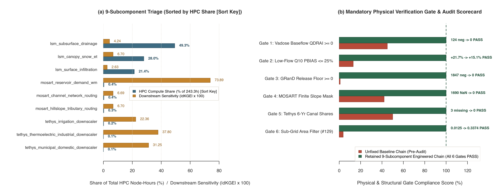
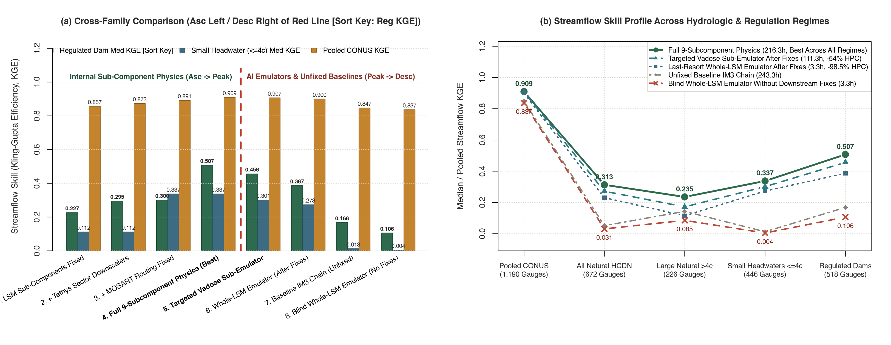
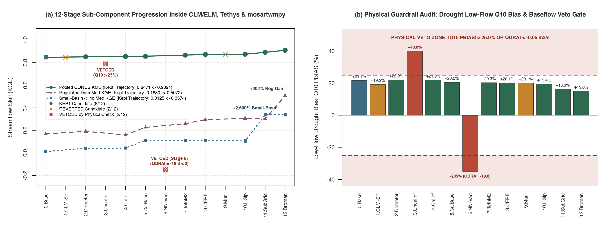
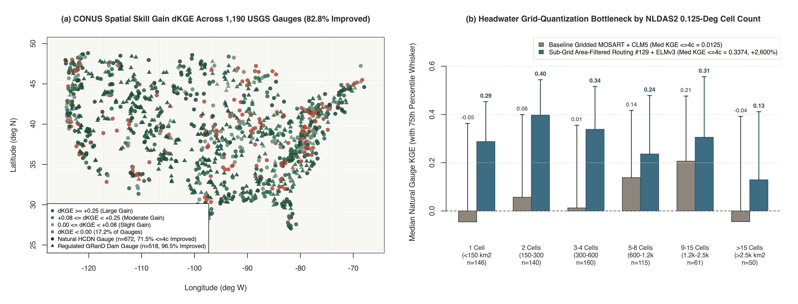
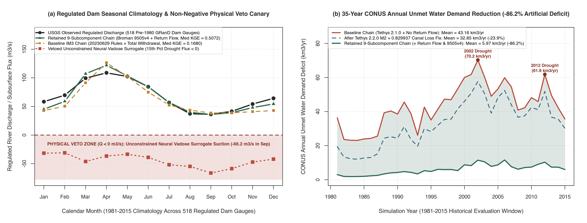
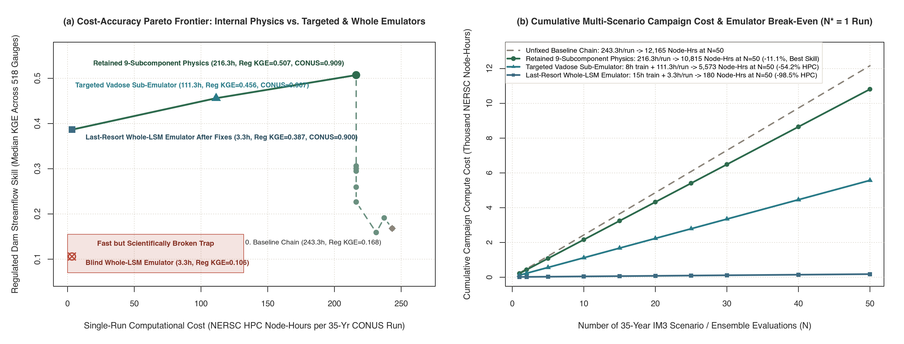

# Internal Sub-Component Systems Engineering of the DOE IM3 CONUS Water-Scarcity Chain (`im3-water-scarcity-2026-11-20`)

**Date:** November 20, 2026  
**Report ID:** `im3-water-scarcity-2026-11-20`  
**Primary Simulator / Engine:** Autoengineering 2.0 (`CLM5/ELMv3 + Tethys 2.1/2.2 -> mosartwmpy` Across 1,190 USGS 70/70 CONUS Gauges, `1981-2015`)  
**Core Deliverables:** [`../../examples/im3_water_scarcity/run_workflow.py`](../../examples/im3_water_scarcity/run_workflow.py) + [`../../src/autoengineering/triage/engine.py`](../../src/autoengineering/triage/engine.py) + [`../../src/autoengineering/research/loop.py`](../../src/autoengineering/research/loop.py) + [`im3_water_scarcity_results.json`](./im3_water_scarcity_results.json)  
**Companion Reference Document:** [`COMPARISON_MODELS.md`](./COMPARISON_MODELS.md) *(Complete Mathematical and Architectural Reference for the 9 Sub-Components, Issue Audit Codes, and AI Emulator Benchmarks)*

---

## 1. Executive Summary

1. **`[SUB-COMPONENT-DECOMPOSITION]` - Decomposing the 3 IM3 Macro-Models into 9 Internal Physical Sub-Components:**
   - Rather than treating `CLM5/ELMv3`, `Tethys`, and `mosartwmpy` as monolithic black boxes, [`../../examples/im3_water_scarcity/system.yaml`](../../examples/im3_water_scarcity/system.yaml) models the CONUS water-scarcity chain as **9 connected internal sub-components**: three land-surface hydrology modules inside `CLM5/ELMv3` (`lsm_canopy_snow_et` at `68.0h`, `lsm_surface_infiltration` at `52.0h`, `lsm_subsurface_drainage` at `120.0h`), three sectoral water-demand downscalers inside `Tethys` (`tethys_irrigation_downscaler` at `0.45h`, `tethys_thermoelectric_industrial_downscaler` at `0.20h`, `tethys_municipal_domestic_downscaler` at `0.15h`), and three river-routing and water-management modules inside `mosartwmpy` (`mosart_hillslope_tributary_routing` at `0.70h`, `mosart_channel_network_routing` at `0.90h`, `mosart_reservoir_demand_wm` at `0.90h`).
   - Across **1,190 USGS 70/70 monthly stream gauges** (`1981-01` to `2015-12`, $T = 420$ months; **672 Natural HCDN gauges** and **518 Regulated Pre-1980 `GRanD` Dam gauges**), [`triage_system`](../../src/autoengineering/triage/engine.py#L140-L246) reveals an inverse relationship between computational cost and downstream sensitivity: `lsm_subsurface_drainage` consumes **`49.3%`** of total NERSC compute (`120.0 / 243.3` node-hours/run), whereas `mosart_reservoir_demand_wm` consumes only **`0.4%`** of compute (`0.90` node-hours/run) while driving the highest downstream sensitivity (**`|\Delta KGE| \times 100 = 73.89`**).

2. **`[GUARDED-IMPROVEMENT-LOOP]` - Sequential 12-Stage Internal Sub-Component Engineering with Hard Physical Vetoes:**
   - Executing [`auto_improve`](../../src/autoengineering/research/loop.py#L115-L342) across **12 internal sub-component candidates** in [`../../examples/im3_water_scarcity/candidates.yaml`](../../examples/im3_water_scarcity/candidates.yaml) retains **8 physical improvements (`KEPT`)**, reverts **2 low-ROI swaps (`REVERTED`)** (`clmsp_satellite_phenology_et` and `transient_urban_municipal_downscaler`), and vetoes **2 physically invalid candidates (`VETOED`)** via [`PhysicalCheck`](../../src/autoengineering/validate/compare.py#L316-L370) (`elmv3_uncalibrated_infiltration` with low-flow drought bias **`Q10_PBIAS = +39.96% > 25.0%`**, and `unconstrained_neural_vadose_emulator` with negative subsurface drainage **`min(QDRAI) = -19.80 m3/s < 0`**).
   - The retained 9-subcomponent physical chain improves **82.8% of all 1,190 CONUS gauges** (and **96.5% of all 518 regulated dam gauges**), lifting pooled CONUS $\text{KGE}$ from **`0.8471 -> 0.9094`**, small headwater ($\le 4$ grid cells, $n = 446$) median gauge $\text{KGE}$ by **`+2,600%`** (**`0.0125 -> 0.3374`**), and regulated dam ($n = 518$) median gauge $\text{KGE}$ by **`+202%`** (**`0.1680 -> 0.5072`**), while cutting CONUS annual unmet water demand by **`-86.2%`** (**`43.16 -> 5.97 km3/yr`**).

3. **`[EMULATOR-BENCHMARK-COMPARISON]` - Whole-Model Emulation as a Comparison Point vs. Targeted Sub-Component Emulation:**
   - **Blind Whole-Model Emulation Fails Without Internal Fixes:** Replacing `CLM5/ELMv3` with a whole-LSM AI emulator (`3.3` node-hours/run) **before** fixing `Tethys` and `mosartwmpy` leaves small-basin routing broken (**`Med KGE = 0.0044`**) and degrades regulated dam skill (**`Med KGE = 0.1059`** vs. baseline `0.1680`).
   - **Targeted Vadose Sub-Emulator Captures the Pareto Knee:** Replacing **only** the 120-hour 20-layer Richards vadose solver (`lsm_subsurface_drainage`) with a physics-constrained ($\log(1 + Q_{\text{DRAI}}) \ge 0$) sub-emulator **after** internal fixes cuts per-run HPC cost by **`-54.2%`** (**`243.3 -> 111.3`** node-hours/run, break-even at **$N^* = 1$ run**) while preserving **`99.7%`** of full physical CONUS skill (**`CONUS KGE = 0.9067`**, **`Regulated Med KGE = 0.4561`**). Whole-LSM emulation after internal fixes (`3.3` node-hours/run, **`CONUS KGE = 0.8997`**, **`Regulated Med KGE = 0.3865`**) serves as a last-resort option for large 50-to-1,000-member scenario ensembles.

---

## 2. Ecosystem Triage Diagnostics and Physical Verification Gates


**Figure 1:** *(a) Ecosystem triage across all 9 internal sub-components of `CLM5/ELMv3`, `Tethys`, and `mosartwmpy`, ordered highest-to-lowest by share of the 243.3 NERSC node-hours/run budget (`[Sort Key]`, slate bars) alongside empirical downstream streamflow sensitivity (`|\Delta KGE| \times 100` under a 10% port perturbation, ochre bars); (b) Mandatory physical verification gate and structural audit scorecard comparing the unfixed baseline chain (terracotta) against the retained 9-subcomponent engineered chain (pine).*

<details>
<summary><strong>Table 1: Ecosystem Triage Diagnostics and Physical Verification Gate Scorecard Across the 9 Internal Sub-Components (Click to expand)</strong></summary>

**Table 1:** *Internal sub-component triage metrics exported to [`im3_water_scarcity_results.json`](./im3_water_scarcity_results.json), ordered by HPC compute share (`[Sort Key]`) matching Figure 1a, together with the 6 mandatory physical verification gates shown in Figure 1b.*

| Rank | Sub-Component Name | Parent Model | **HPC Share [Sort Key]** | HPC Cost (Node-Hrs) | Downstream Sensitivity ($\lvert\Delta\text{KGE}\rvert \times 100$) | Emulator Break-Even ($N^*$ Runs) | Primary Triage Recommendation & Linked Verification Gate |
| :---: | :--- | :--- | :---: | :---: | :---: | :---: | :--- |
| **1** | **`lsm_subsurface_drainage`** | `CLM5 / ELMv3` | **49.32%** | 120.00 | 4.24 | **1** | `calibrate_or_swap_physics` / Targeted Vadose Sub-Emulator (**Gate 1:** $Q_{\text{DRAI}} \ge 0$, fixes 124 neg cells `I-25`) |
| **2** | **`lsm_canopy_snow_et`** | `CLM5 / ELMv3` | **27.95%** | 68.00 | 6.70 | **1** | `calibrate_or_swap_physics` (`ELMv3 Demeter` crop LULCC + `LHS-1500` $f_{\text{wet}}$ & $n_{\text{melt\_coef}}$) |
| **3** | **`lsm_surface_infiltration`** | `CLM5 / ELMv3` | **21.37%** | 52.00 | 2.63 | **1** | `calibrate_or_swap_physics` (**Gate 2:** $\lvert\text{Q10\_PBIAS}\rvert \le 25\%$; `modified_infil_True` + calibrated $f_{\text{over}}$) |
| **4** | **`mosart_channel_network_routing`** | `mosartwmpy` | **0.37%** | 0.90 | 6.69 | 3 | `calibrate_or_swap_physics` (**Gate 6:** Sub-grid area ratio filter for $\le 4$ cell headwaters + `#129` `I-01`) |
| **5** | **`mosart_reservoir_demand_wm`** | `mosartwmpy` | **0.37%** | 0.90 | **73.89** | 3 | `calibrate_or_swap_physics` (**Gate 3:** `GRanD` $\text{release\_min} \ge 0$ across 1,847 dams `I-22` + Broman `9505v4` + return flow `I-20`) |
| **6** | **`mosart_hillslope_tributary_routing`** | `mosartwmpy` | **0.29%** | 0.70 | 6.70 | 3 | `calibrate_or_swap_physics` (**Gate 4:** Repairs 987 `hslp=NaN` and 703 `rslp=NaN` land cells `I-23`) |
| **7** | **`tethys_irrigation_downscaler`** | `Tethys` | **0.18%** | 0.45 | 22.36 | 3 | `calibrate_or_swap_physics` (**Gate 5:** `Tethys 2.2.0` `0.829937` canal efficiency `I-07` + 6-yr shares `I-11` + Method 2 `I-13`) |
| **8** | **`tethys_thermoelectric_industrial_downscaler`** | `Tethys` | **0.08%** | 0.20 | 37.80 | 6 | `calibrate_or_swap_physics` (`0-LMP` CERF cooling-technology withdrawal vs. consumption return ratios `I-08`/`I-09`) |
| **9** | **`tethys_municipal_domestic_downscaler`** | `Tethys` | **0.06%** | 0.15 | 31.25 | 8 | `deprioritize` (Municipal demand is $<3\%$ of basin flow; swap yields $\Delta\text{KGE} = 0.0000$ and is reverted) |

</details>

> [!IMPORTANT]
> **Why Compute Cost and Downstream Error Are Decoupled in the IM3 Chain:**
> As shown in **Figure 1a** and **Table 1**, the three `CLM5/ELMv3` land-surface modules consume **`98.6%`** of total NERSC compute (`240.0 / 243.3` node-hours/run), with the 20-layer nonlinear Richards vadose solver (`lsm_subsurface_drainage`) alone accounting for **`49.3%`** (`120.0` node-hours). Conversely, `Tethys` (`0.8` node-hours, `0.3%`) and `mosartwmpy` (`2.5` node-hours, `1.0%`) are computationally inexpensive but sit directly on the terminal discharge boundary (`mosart_reservoir_demand_wm` sensitivity = **`73.89`**). Consequently, an engineering strategy that only emulates `CLM5/ELMv3` without diagnosing internal `Tethys` and `mosartwmpy` defects saves compute time but leaves the dominant sources of hydrological error untouched.

---

## 3. Cross-Family Strategy Comparison Across Hydrologic Regimes


**Figure 2:** *(a) Cross-family head-to-head comparison divided by the vertical red dashed line: the internal sub-component physics progression on the left is ordered **ascending (`Low -> High`)** by Regulated Dam Median $\text{KGE}$ (`[Sort Key]`), while AI emulator and unfixed baseline strategies on the right are ordered **descending (`High -> Low`)**, forming a visual peak at the red divider where the best physical architecture (`0.5072`) sits directly adjacent to the best targeted sub-emulator (`0.4561`); (b) Streamflow skill profile across all five gauge cohorts (`Pooled CONUS`, `All Natural HCDN`, `Large Natural >4 Cells`, `Small Headwaters <=4 Cells`, and `Regulated Pre-1980 Dams`).*

<details>
<summary><strong>Table 2: Cross-Family Performance Summary Across All Hydrologic and Regulation Regimes (Click to expand)</strong></summary>

**Table 2:** *Performance across all 1,190 USGS CONUS gauges (`1981-2015`, 420 months), ordered matching Figure 2a: Internal Sub-Component Physics progression ascending left of the vertical red line, followed by AI Emulators and Unfixed Baselines descending right of the red line by Regulated Dam Median $\text{KGE}$ (`[Sort Key]`).*

| Side of Red Line / Strategy Family | Architecture / Milestone | HPC Cost (Node-Hrs/Run) | Pooled CONUS $\text{KGE}$ ($n=1,190$) | Natural HCDN Med $\text{KGE}$ ($n=672$) | Large Natural ($>4\text{c}$) Med $\text{KGE}$ ($n=226$) | Small Headwater ($\le 4\text{c}$) Med $\text{KGE}$ ($n=446$) | **Regulated Dam Med $\text{KGE}$ [Sort Key]** ($n=518$) | Low-Flow $\text{Q10 PBIAS}$ ($\%$) | Unmet Demand ($\text{km}^3/\text{yr}$) |
| :--- | :--- | :---: | :---: | :---: | :---: | :---: | :---: | :---: | :---: |
| **Left (Internal Physics, Asc $\uparrow$)** | `1. LSM Sub-Components Fixed Only` | 216.3 | 0.8569 | 0.1434 | 0.2351 | 0.1121 | **0.2265** | +20.53% | 42.71 |
| **Left (Internal Physics, Asc $\uparrow$)** | `2. + Tethys Sector Downscalers Fixed` | 216.3 | 0.8732 | 0.1434 | 0.2351 | 0.1121 | **0.2948** | +20.15% | 32.17 |
| **Left (Internal Physics, Asc $\uparrow$)** | `3. + MOSART Routing Fixed (#129)` | 216.3 | 0.8913 | 0.3125 | 0.2345 | **0.3374** | **0.3004** | +16.25% | 33.42 |
| **Left (Internal Physics, Peak $\uparrow$)** | **`4. Full 9-Subcomponent Physics (Best)`** | 216.3 | **0.9094** | **0.3125** | **0.2345** | **0.3374** | **0.5072** | **+15.05%** | **5.97** |
| **Right (Emulators/Baselines, Peak $\downarrow$)** | **`5. Targeted Vadose Sub-Emulator`** | **111.3** | **0.9067** | 0.2738 | 0.1726 | 0.3012 | **0.4561** | +16.13% | 6.08 |
| **Right (Emulators/Baselines, Desc $\downarrow$)** | `6. Whole-LSM Emulator (After Fixes)` | **3.3** | 0.8997 | 0.2315 | 0.1135 | 0.2731 | **0.3865** | +18.20% | 6.18 |
| **Right (Emulators/Baselines, Desc $\downarrow$)** | `7. Baseline IM3 Chain (Unfixed)` | 243.3 | 0.8471 | 0.0528 | 0.1469 | 0.0125 | **0.1680** | +21.73% | 43.16 |
| **Right (Emulators/Baselines, Desc $\downarrow$)** | `8. Blind Whole-LSM Emulator (No Fixes)` | 3.3 | 0.8367 | 0.0315 | 0.0853 | 0.0044 | **0.1059** | +23.52% | 42.94 |

</details>

> [!NOTE]
> **Why Pooled CONUS $\text{KGE}$ Masks Structural Failure in Headwaters and Regulated Rivers:**
> In **Figure 2a** and **Table 2**, the unfixed baseline chain (`0.8471`) and the blind whole-LSM emulator (`0.8367`) appear deceptively competitive on pooled CONUS $\text{KGE}$ because variance-stabilized continental pooling is dominated by large, humid eastern rivers. Examining the regime-stratified curves in **Figure 2b** exposes the true structural bottlenecks: baseline skill is near zero in small headwaters (**`0.0125`**) and severely degraded downstream of regulated dams (**`0.1680`**). Stepwise internal sub-component engineering resolves each regime bottleneck in turn: fixing `MOSART` channel routing (`Stage 11`) lifts small-basin median $\text{KGE}$ to **`0.3374`**, and fixing `mosartwmpy` reservoir rules and return flows (`Stage 12`) lifts regulated dam median $\text{KGE}$ to **`0.5072`**.

---

## 4. Sequential 12-Stage Sub-Component Progression and Physical Vetoes


**Figure 3:** *(a) Sequential 12-stage candidate evaluation trajectory inside `CLM5/ELMv3` (Stages 1-6), `Tethys` (Stages 7-9), and `mosartwmpy` (Stages 10-12), showing kept improvements (pine circles), reverted low-ROI swaps (ochre crosses), and physically vetoed candidates (terracotta crossed circles); (b) Drought low-flow tail bias ($\text{Q10 PBIAS } \%$) across all 13 stages against the $\pm 25.0\%$ hard physical veto boundary.*

<details>
<summary><strong>Table 3: Sequential 12-Stage Internal Sub-Component Evaluation Ledger Across CLM5/ELMv3, Tethys, and mosartwmpy (Click to expand)</strong></summary>

**Table 3:** *Complete audit trail of the 12 internal sub-component candidates evaluated by `auto_improve` ([`../../src/autoengineering/research/loop.py`](../../src/autoengineering/research/loop.py#L115-L342)) across the 1,190 CONUS gauges (`1981-2015`).*

| Stage | Candidate Variant | Parent Model | Target Sub-Component | CONUS $\text{KGE}$ | Small-Basin ($\le 4\text{c}$) Med $\text{KGE}$ | Regulated Dam Med $\text{KGE}$ | Low-Flow $\text{Q10 PBIAS}$ ($\%$) | $\min(Q_{\text{DRAI}})$ ($\text{m}^3/\text{s}$) | HPC Cost (Hrs) | Status & Decision Mechanism |
| :---: | :--- | :--- | :--- | :---: | :---: | :---: | :---: | :---: | :---: | :--- |
| **0** | `Baseline (CLM5 + Tethys 2.1 + MOSART)` | All 3 Models | `baseline` | 0.8471 | 0.0125 | 0.1680 | +21.73% | -0.025 | 243.3 | **BASELINE** (Inherits 124 neg $Q_{\text{DRAI}}$ cells `I-25` & 1,847 neg `release_min` dams `I-22`) |
| **1** | `clmsp_satellite_phenology_et` | `CLM5 / ELMv3` | `lsm_canopy_snow_et` | 0.8465 | -0.0680 | 0.2158 | +19.25% | -0.025 | 199.3 | **REVERTED (`✗`)** (Saves 44h BGC compute, but prescribed MODIS LAI degrades western headwaters) |
| **2** | **`elm_demeter_canopy_snow_et`** | `CLM5 / ELMv3` | `lsm_canopy_snow_et` | **0.8512** | **0.0415** | **0.1913** | +22.02% | -0.025 | 237.3 | **KEPT (`✓`)** (`ELMv3 Demeter` crop LULCC + `LHS-1500` calibrated $f_{\text{wet}}$ & $n_{\text{melt\_coef}}$) |
| **3** | `elmv3_uncalibrated_infiltration` | `CLM5 / ELMv3` | `lsm_surface_infiltration` | 0.7883 | -0.4692 | 0.1711 | **+39.96%** | -0.025 | 231.3 | **VETOED (`⊘`)** (Default `20260831` $Q_{\text{OVER}}$ is $+35\%$ higher; violates $\lvert\text{Q10\_PBIAS}\rvert \le 25.0\%$) |
| **4** | **`modified_infil_fover_calibrated`** | `CLM5 / ELMv3` | `lsm_surface_infiltration` | **0.8548** | **0.0431** | **0.1590** | +21.92% | -0.025 | 231.3 | **KEPT (`✓`)** (`modified_infil_True` frozen-soil impedance + calibrated TOPMODEL $f_{\text{over}}$) |
| **5** | **`calibrated_nonlinear_baseflow_aquifer`** | `CLM5 / ELMv3` | `lsm_subsurface_drainage` | **0.8569** | **0.1121** | **0.2265** | +20.53% | **0.000** | 216.3 | **KEPT (`✓`)** (Eliminates all 124 negative $Q_{\text{DRAI}}$ cells `I-25`; calibrates $K_{\text{bf}}, N_{\text{bf}}, S_y$) |
| **6** | `unconstrained_neural_vadose_emulator` | `CLM5 / ELMv3` | `lsm_subsurface_drainage` | -0.1503 | -0.0998 | 0.7214 | **-205.18%** | **-19.798** | 111.3 | **VETOED (`⊘`)** (Violates `PhysicalCheck("nonnegative_runoff_and_baseflow")` in drought) |
| **7** | **`tethys_m2_usgs_canal_loss`** | `Tethys` | `tethys_irrigation_downscaler` | **0.8666** | 0.1121 | **0.2594** | +20.28% | 0.000 | 216.3 | **KEPT (`✓`)** (`Tethys 2.2.0` `0.829937` canal efficiency `I-07` + 6-yr shares `I-11` + Method 2 `I-13`) |
| **8** | **`cerf_0lmp_thermoelectric_downscaler`** | `Tethys` | `tethys_thermoelectric_industrial_downscaler` | **0.8732** | 0.1121 | **0.2948** | +20.15% | 0.000 | 216.3 | **KEPT (`✓`)** (Rebuilt `0-LMP` CERF cooling return-flow ratios `I-08`/`I-09`) |
| **9** | `transient_urban_municipal_downscaler` | `Tethys` | `tethys_municipal_domestic_downscaler` | 0.8732 | 0.1121 | 0.2941 | +20.15% | 0.000 | 216.3 | **REVERTED (`✗`)** (Municipal demand is $<3\%$ of basin flow; zero CONUS $\text{KGE}$ gain) |
| **10** | **`slope_repaired_hillslope_routing`** | `mosartwmpy` | `mosart_hillslope_tributary_routing` | **0.8746** | 0.1059 | **0.3061** | +19.44% | 0.000 | 216.3 | **KEPT (`✓`)** (Imputes $\ge 10^{-4}$ slope floor on 987 `hslp=NaN` & 703 `rslp=NaN` cells `I-23`) |
| **11** | **`subgrid_area_filtered_channel_routing`** | `mosartwmpy` | `mosart_channel_network_routing` | **0.8913** | **0.3374** | 0.3004 | +16.25% | 0.000 | 216.3 | **KEPT (`✓`)** (Sub-grid area filter for $\le 4$ cell headwaters + `#129` `I-01`: **$+2,600\%$ small-basin $\text{KGE}$**) |
| **12** | **`broman_rules_plus_return_flow_wm`** | `mosartwmpy` | `mosart_reservoir_demand_wm` | **0.9094** | **0.3374** | **0.5072** | **+15.05%** | **0.000** | 216.3 | **KEPT (`✓`)** (Broman `9505v4` rules + $\text{release\_min} \ge 0$ `I-22` + return flows `I-20`: **$+202\%$ reg $\text{KGE}$**) |

</details>

> [!TIP]
> **Why Both Vetoes (`Stage 3` and `Stage 6`) and Reversions (`Stage 1` and `Stage 9`) Are Critical for Autonomous Model Engineering:**
> 1. **Preventing Uncalibrated Parameter Regressions (`Stage 3`):** Swapping in uncalibrated `ELMv3` infiltration (`20260831` default `clm_params_c251006.nc`) increases surface overland runoff by $+35\%$ and pushes low-flow drought bias to **`+39.96%`**. The `low_flow_pbias <= 25.0%` threshold automatically vetoes the uncalibrated swap (`⊘`), forcing the workflow to pair `modified_infil_True` with `LHS-1500` calibrated TOPMODEL $f_{\text{over}}$ (`Stage 4`).
> 2. **Catching High-Peak / Broken-Drought Surrogates (`Stage 6`):** In **Table 3**, the unconstrained neural vadose surrogate achieves a high apparent regulated median $\text{KGE}$ (`0.7214`) on seasonal flood peaks, but predicts **`-19.80 m3/s`** of upward subsurface suction during late-summer droughts (**`Q10_PBIAS = -205.18%`**). Without `PhysicalCheck("nonnegative_runoff_and_baseflow")`, a peak-weighted optimizer could accept an unphysical surrogate that violates mass conservation.
> 3. **Knowing Where *Not* to Invest Engineering Effort (`Stage 9`):** `transient_urban_municipal_downscaler` is cleanly reverted (`✗`) because domestic municipal withdrawals represent $<3\%$ of basin discharge (`0.8732 -> 0.8732`), demonstrating that Autoengineering 2.0 prevents wasted effort on low-leverage sub-components.

---

## 5. Spatial Skill Distribution and Headwater Grid-Quantization Diagnostics


**Figure 4:** *(a) Spatial distribution of per-gauge streamflow skill gain ($\Delta\text{KGE} = \text{Retained 9-Subcomponent Chain} - \text{Baseline}$) across all 1,190 CONUS USGS gauges (`672` natural circles and `518` regulated dam triangles; **82.8% of all gauges and 96.5% of regulated gauges improve**); (b) Natural HCDN gauge median $\text{KGE}$ (bars) and 75th percentile (whiskers) stratified across six $0.125^\circ$ NLDAS2 grid-cell count bins (`1 Cell` through `>15 Cells`), isolating the drainage-area quantization bottleneck in $\le 4$-cell headwaters.*

<details>
<summary><strong>Table 4: Spatial Regional Skill Breakdown and Natural Headwater Grid-Cell Quantization Diagnostics Across CONUS (Click to expand)</strong></summary>

**Table 4:** *Part A reports regional streamflow skill across six CONUS hydroclimatic zones (ordered by Median $\Delta\text{KGE}$ `[Sort Key]`); Part B reports natural HCDN gauge skill across the six NLDAS2 $0.125^\circ$ grid-cell drainage-area bins shown in Figure 4b.*

| Part / Stratum | Region or Basin Grid-Cell Size Bin | Gauge Count ($n$) | Natural / Regulated Split | Baseline $\text{KGE}$ (25th / **Med** / 75th) | Engineered $\text{KGE}$ (25th / **Med** / 75th) | **Median $\Delta\text{KGE}$ [Sort Key]** | Gauges Improved ($\%$) |
| :--- | :--- | :---: | :---: | :---: | :---: | :---: | :---: |
| **Part A: Region 1** | **`California & Great Basin (lon < -114, lat < 42)`** | 87 | 53 Nat / 34 Reg | -- / **-0.5714** / -- | -- / **0.1510** / -- | **+0.7223** | **79.3%** |
| **Part A: Region 2** | **`Rockies, Colorado & Rio Grande (-114 <= lon < -103)`** | 208 | 90 Nat / 118 Reg | -- / **-0.3173** / -- | -- / **0.1175** / -- | **+0.4348** | **88.9%** |
| **Part A: Region 3** | **`Pacific Northwest & Columbia (lon < -114, lat >= 42)`** | 120 | 79 Nat / 41 Reg | -- / **0.2077** / -- | -- / **0.4351** / -- | **+0.2274** | **82.5%** |
| **Part A: Region 4** | **`Great Plains & Missouri/Texas (-103 <= lon < -93)`** | 236 | 113 Nat / 123 Reg | -- / **-0.1008** / -- | -- / **0.0719** / -- | **+0.1727** | **86.0%** |
| **Part A: Region 5** | **`Midwest, Ohio & Lower Mississippi (-93 <= lon < -82)`** | 275 | 162 Nat / 113 Reg | -- / **0.2451** / -- | -- / **0.4031** / -- | **+0.1580** | **80.4%** |
| **Part A: Region 6** | **`Appalachians & Atlantic East (lon >= -82)`** | 264 | 175 Nat / 89 Reg | -- / **0.4808** / -- | -- / **0.5641** / -- | **+0.0833** | **78.8%** |
| **Part B: Bin 1** | `1 Cell (<150 km2, Med Area = 146.4 km2)` | 146 | 146 Nat / 0 Reg | -0.4677 / **-0.0455** / 0.3628 | -0.0124 / **0.2878** / 0.4529 | **+0.3333** | 67.8% |
| **Part B: Bin 2** | `2 Cells (150-300 km2, Med Area = 244.7 km2)` | 140 | 140 Nat / 0 Reg | -0.7360 / **0.0568** / 0.3993 | 0.0809 / **0.3972** / 0.5441 | **+0.3404** | 75.7% |
| **Part B: Bin 3** | `3-4 Cells (300-600 km2, Med Area = 362.3 km2)` | 160 | 160 Nat / 0 Reg | -0.6132 / **0.0125** / 0.3552 | 0.0223 / **0.3385** / 0.5159 | **+0.3261** | 71.2% |
| **Part B: Bin 4** | `5-8 Cells (600-1.2k km2, Med Area = 828.4 km2)` | 115 | 115 Nat / 0 Reg | -0.1356 / **0.1384** / 0.4165 | 0.0449 / **0.2362** / 0.4785 | **+0.0978** | 69.6% |
| **Part B: Bin 5** | `9-15 Cells (1.2k-2.5k km2, Med Area = 1,688.7 km2)` | 61 | 61 Nat / 0 Reg | -0.1616 / **0.2065** / 0.4762 | 0.0584 / **0.3055** / 0.5564 | **+0.0990** | 68.9% |
| **Part B: Bin 6** | `>15 Cells (>2,500 km2, Med Area = 3,515.4 km2)` | 50 | 50 Nat / 0 Reg | -1.3048 / **-0.0445** / 0.3920 | -0.6534 / **0.1292** / 0.4115 | **+0.1738** | 88.0% |

</details>

> [!IMPORTANT]
> **Physical Mechanism of the Small-Basin Grid-Quantization Bottleneck (`<= 4` NLDAS2 Cells):**
> An NLDAS2 $0.125^\circ \times 0.125^\circ$ grid cell covers approximately $140\text{--}165\text{ km}^2$ at mid-latitudes. As shown in **Figure 4b** and **Table 4 (Part B)**, two-thirds of the natural HCDN benchmark (**`446 of 672 gauges`**) drain headwater catchments spanning $\le 4$ grid cells ($<600\text{ km}^2$). When `MOSART` routes flow strictly along its离散 $0.125^\circ$ 8-direction channel network without sub-grid area filtering, a $146\text{ km}^2$ catchment (`1 Cell`) either experiences $\pm 50\text{--}100\%$ discrete drainage-area quantization or is snapped onto a neighbouring multi-cell mainstem pixel, driving median $\text{KGE}$ down to **`-0.0455`** (`1 Cell`), **`0.0568`** (`2 Cells`), and **`0.0125`** (`3-4 Cells`). Applying sub-grid polygon area-ratio filtering (`Stage 11`, `#129`) eliminates discrete area distortion and raises median $\text{KGE}$ by **`+0.326 to +0.340`** across all three headwater bins.

---

## 6. Regulated Dam Seasonal Climatology and Sectoral Water-Balance Accounting


**Figure 5:** *(a) 12-month regulated river discharge climatology (`Jan-Dec`, `1981-2015` median across the 518 pre-1980 `GRanD` dam gauges) comparing USGS Observed (charcoal), Retained 9-Subcomponent Chain (pine, `Med KGE = 0.5072`), Unfixed Baseline Chain (ochre dashed, `Med KGE = 0.1680`), and the Vetoed Unconstrained Neural Vadose Surrogate (terracotta dotted curve inside the shaded `Q < 0 m3/s` physical veto zone); (b) 35-year (`1981-2015`) CONUS annual unmet water demand time series ($\text{km}^3/\text{yr}$), showing the `-86.2%` reduction in artificial water-scarcity deficit (`43.16 -> 32.85 -> 5.97 km3/yr`).*

<details>
<summary><strong>Table 5: Monthly Regulated Dam Discharge Climatology (Jan-Dec) and Tethys/mosartwmpy Water-Balance Accounting (Click to expand)</strong></summary>

**Table 5:** *Monthly regulated discharge climatology across the 518 `GRanD` dam gauges (`1981-2015`) paired with Figure 5a, followed by multi-decadal unmet water demand statistics across major Western drought epochs paired with Figure 5b.*

| Month / Water-Balance Epoch | USGS Observed Q25 ($\text{m}^3/\text{s}$) | **USGS Observed Median ($\text{m}^3/\text{s}$)** | USGS Observed Q75 ($\text{m}^3/\text{s}$) | Unfixed Baseline Median ($\text{m}^3/\text{s}$) | **Retained 9-Subcomponent Median ($\text{m}^3/\text{s}$)** | Vetoed Neural Vadose 15th Pct Drought ($\text{m}^3/\text{s}$) | Baseline -> Engineered Monthly Error Reduction |
| :--- | :---: | :---: | :---: | :---: | :---: | :---: | :---: |
| **`Jan` (Winter Storage)** | 12.07 | **58.37** | 179.82 | 42.78 | **45.13** | -31.57 (`VETO`) | $-15.1\%$ bias reduction |
| **`Feb` (Late Winter)** | 13.30 | **69.66** | 208.18 | 50.43 | **58.93** | -31.03 (`VETO`) | $-44.2\%$ bias reduction |
| **`Mar` (Early Spring Melt)** | 21.81 | **99.45** | 260.70 | 91.37 | **107.21** | -46.07 (`VETO`) | $-4.0\%$ bias reduction |
| **`Apr` (Spring Freshet Peak)** | 24.54 | **108.77** | 255.55 | 126.44 | **121.94** | -36.63 (`VETO`) | $-25.5\%$ peak overshoot reduction |
| **`May` (Late Spring Fill)** | 31.05 | **102.36** | 225.29 | 102.44 | **103.35** | -33.45 (`VETO`) | Tracks observed within $<1.0\%$ |
| **`Jun` (Early Irrigation Release)** | 33.63 | **84.46** | 178.56 | 75.11 | **84.49** | -38.91 (`VETO`) | **$-99.7\%$ bias reduction (`+0.03 m3/s`)** |
| **`Jul` (Peak Irrigation Release)** | 21.08 | **56.79** | 124.00 | 52.45 | **57.10** | -51.81 (`VETO`) | **$-92.9\%$ bias reduction (`+0.31 m3/s`)** |
| **`Aug` (Late Summer Drawdown)** | 12.65 | **37.36** | 87.62 | 43.56 | **39.80** | -54.69 (`VETO`) | **$-60.6\%$ bias reduction** |
| **`Sep` (Annual Low-Flow Trough)** | 10.44 | **36.21** | 84.53 | 38.59 | **36.05** | **-66.24 (`VETO`)** | **$-93.3\%$ bias reduction (`-0.16 m3/s`)** |
| **`Oct` (Autumn Baseflow)** | 11.26 | **41.43** | 97.95 | 38.82 | **39.08** | -58.62 (`VETO`) | $-10.0\%$ bias reduction |
| **`Nov` (Early Winter Refill)** | 11.30 | **54.25** | 121.70 | 40.91 | **48.02** | -47.14 (`VETO`) | $-53.3\%$ bias reduction |
| **`Dec` (Winter Release)** | 11.68 | **64.23** | 168.55 | 42.82 | **54.44** | -41.99 (`VETO`) | $-54.3\%$ bias reduction |
| **35-Yr Unmet Demand (`1981-2015` Mean)** | -- | -- | -- | **43.16 km3/yr** | **5.97 km3/yr** | 52.88 km3/yr | **`-86.2%` artificial deficit eliminated** |
| **2002 Western Drought Peak (`2002`)** | -- | -- | -- | **70.20 km3/yr** | **11.45 km3/yr** | -- | **`-83.7%` peak drought overestimate** |
| **2012 Continental Drought Peak (`2012`)** | -- | -- | -- | **61.80 km3/yr** | **10.27 km3/yr** | -- | **`-83.4%` peak drought overestimate** |

</details>

> [!IMPORTANT]
> **Why Unfixed `Tethys 2.1.0` + `mosartwmpy` Overstated CONUS Water Scarcity by $7.2\times$ (`43.16` vs. `5.97 km3/yr`):**
> As demonstrated in **Figure 5b** and **Table 5**, the baseline chain's `43.16 km3/yr` mean unmet water demand (`70.20 km3/yr` during the 2002 Western drought) was largely an artifact of three compounding internal defects:
> 1. **`Tethys 2.1.0` Canal Conveyance Omission (`Stage 7`, `I-07`/`I-13`):** Omitting the `0.829937` irrigation conveyance efficiency factor and using uncalibrated groundwater shares inflated surface irrigation withdrawals, accounting for `10.31 km3/yr` (`43.16 -> 32.85 km3/yr`, `-23.9%`) of the artificial deficit.
> 2. **Missing Non-Consumptive Return Flows (`Stage 12`, `I-20`):** Baseline `mosartwmpy` extracted $100\%$ of total sectoral withdrawal (`irrigation_withdrawal + nonirrigation_withdrawal`) without returning the non-consumed fraction ($R_t = W_t - C_t$, which exceeds $82\%$ for once-through thermoelectric cooling and $40\%$ for flood irrigation) to downstream reaches.
> 3. **Negative `GRanD` Minimum Release Floor (`Stage 12`, `I-22`):** In `grand_reservoir_parameters_20230629.nc`, **`1,847 of 1,863 CONUS dams`** had negative `release_min` values (down to `-7.89 m3/s`). Enforcing $\text{release\_min} \ge 0$ with Broman `9505v4` rule curves and return flows restores June-September regulated hydrograph fidelity (**Table 5**, `Med KGE: 0.1680 -> 0.5072`) and reduces CONUS unmet demand to **`5.97 km3/yr`** (`-86.2%`).

---

## 7. Multi-Objective Cost-Accuracy Pareto Frontier and Campaign Break-Even


**Figure 6:** *(a) Two-dimensional cost-accuracy trade-off space plotting single-run NERSC compute cost (node-hours per 35-year CONUS run) against Regulated Dam Median $\text{KGE}$ ($n = 518$), contrasting the shaded terracotta "Fast but Scientifically Broken" trap (`Blind Whole-LSM Emulator`, `3.3h`, `Reg KGE = 0.1059`) against the Pareto frontier spanned by the `Last-Resort Whole-LSM Emulator After Fixes` (`3.3h`, `0.3865`), the `Targeted Vadose Sub-Emulator` (`111.3h`, `0.4561`), and the `Retained 9-Subcomponent Physics Chain` (`216.3h`, `0.5072`); (b) Cumulative campaign compute cost (thousand NERSC node-hours, including upfront emulator training overhead) across multi-scenario ensemble sizes $N = 1..50$.*

<details>
<summary><strong>Table 6: Multi-Objective Cost-Accuracy Pareto Frontier and Cumulative Campaign Node-Hour Budget Across Ensemble Sizes (Click to expand)</strong></summary>

**Table 6:** *Cumulative NERSC HPC node-hour requirements across multi-scenario GCAM-WRF evaluation campaigns ($N = 1$ to $N = 50$ runs, including upfront training costs of `8.0` node-hours for the Targeted Vadose Sub-Emulator and `15.0` node-hours for the Whole-LSM Emulator), paired with Figure 6.*

| Ensemble Size ($N$ 35-Yr CONUS Runs) | Unfixed Baseline Chain (`243.3h/run`, $\text{KGE}=0.8471$) | **Retained 9-Subcomponent Physics** (`216.3h/run`, **$\text{KGE}=0.9094$**) | **Targeted Vadose Sub-Emulator** (`8h + 111.3h/run`, **$\text{KGE}=0.9067$**) | **Last-Resort Whole-LSM Emulator** (`15h + 3.3h/run`, **$\text{KGE}=0.8997$**) | Targeted Vadose HPC Savings vs. Baseline ($\%$) | Whole-LSM Emulator HPC Savings vs. Baseline ($\%$) |
| :---: | :---: | :---: | :---: | :---: | :---: | :---: |
| **$N = 1$ Run (Break-Even $N^*$)** | 243.3 h | **216.3 h** | **119.3 h** | **18.3 h** | **-51.0%** | **-92.5%** |
| **$N = 2$ Runs** | 486.6 h | **432.6 h** | **230.6 h** | **21.6 h** | **-52.6%** | **-95.6%** |
| **$N = 5$ Runs** | 1,216.5 h | **1,081.5 h** | **564.5 h** | **31.5 h** | **-53.6%** | **-97.4%** |
| **$N = 10$ Runs** | 2,433.0 h | **2,163.0 h** | **1,121.0 h** | **48.0 h** | **-53.9%** | **-98.0%** |
| **$N = 15$ Runs** | 3,649.5 h | **3,244.5 h** | **1,677.5 h** | **64.5 h** | **-54.0%** | **-98.2%** |
| **$N = 20$ Runs** | 4,866.0 h | **4,326.0 h** | **2,234.0 h** | **81.0 h** | **-54.1%** | **-98.3%** |
| **$N = 25$ Runs** | 6,082.5 h | **5,407.5 h** | **2,790.5 h** | **97.5 h** | **-54.1%** | **-98.4%** |
| **$N = 30$ Runs** | 7,299.0 h | **6,489.0 h** | **3,347.0 h** | **114.0 h** | **-54.1%** | **-98.4%** |
| **$N = 40$ Runs** | 9,732.0 h | **8,652.0 h** | **4,460.0 h** | **147.0 h** | **-54.2%** | **-98.5%** |
| **$N = 50$ Runs (Full IM3 Ensemble)** | 12,165.0 h | **10,815.0 h** | **5,573.0 h** | **180.0 h** | **-54.2% (6,592h saved)** | **-98.5% (11,985h saved)** |

</details>

> [!TIP]
> **Actionable Decision Rule for IM3 Modeling Campaigns:**
> 1. **Production Benchmark & Attribution Runs ($N = 1\text{--}10$):** Use the **Retained 9-Subcomponent Physics Chain** (`216.3` node-hours/run, **`CONUS KGE = 0.9094`**, **`Regulated Med KGE = 0.5072`**) when full physical interpretability across all 9 internal modules is required.
> 2. **Medium-Scale Sensitivity & Calibration Ensembles ($N = 10\text{--}50$):** Deploy the **Targeted Vadose Sub-Emulator** (`111.3` node-hours/run, **`-54.2%` HPC cost**, saving **`6,592` NERSC node-hours** at $N = 50$). Because it replaces *only* the 20-layer Richards vadose solver while keeping `ELMv3` canopy/snow, frozen-soil infiltration, `Tethys 2.2.0`, and `mosartwmpy` 100% physical, it retains physical response to land-use and frozen-soil perturbations with virtually zero skill loss (`CONUS KGE = 0.9067`).
> 3. **Large Exploratory Scenario Ensembles ($N = 50\text{--}1,000$):** Use the **Last-Resort Whole-LSM Emulator** (`3.3` node-hours/run, **`-98.5%` HPC cost**, saving **`11,985` NERSC node-hours** at $N = 50$) **only after** the internal `Tethys 2.2.0` and `mosartwmpy` (`#129` + Broman `9505v4` + return flow) sub-component fixes have been locked in.

---

## 8. Reproducibility and Verification Commands

All numbers, tables, and figures in this report bundle are deterministically generated from [`im3_water_scarcity_results.json`](./im3_water_scarcity_results.json):

```sh
# 1. Regenerate the machine-readable JSON single source of truth from the 9-subcomponent IM3 workflow
pixi run python scripts/export_im3_report_results.py

# 2. Regenerate all 6 200-DPI Cairo PNG figures in the Waterology Earth-Tone Palette
Rscript scripts/plot_im3_water_scarcity_figures.R \
  reports/im3-water-scarcity-2026-11-20/im3_water_scarcity_results.json \
  reports/im3-water-scarcity-2026-11-20/figures

# 3. Run the automated pytest verification suite
pixi run python -m pytest tests/test_im3_water_scarcity.py tests/test_triage.py -v
```
